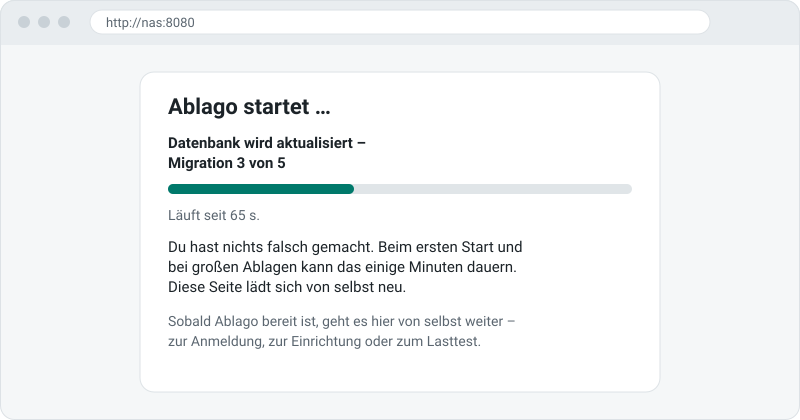

# Aktualisieren und Sichern

--8<-- "ausgeblendet-schritt.md"

## Aktualisieren

1. **Vorher sichern:** **Werkbank → [Sicherung](sicherung.md) → Jetzt sichern.** Das ist dein Rückweg, falls nach dem Update etwas nicht stimmt – dauert meist nur Minuten.
2. Lies unter [Releases](https://github.com/motom001/dms/releases), was sich geändert hat.
3. Schalte den [Wartungsmodus](wartungsmodus.md) ein, damit niemand mitten im Update arbeitet.
4. Image neu ziehen und das Projekt neu starten – auf der Kommandozeile:
   ```sh
   docker compose pull && docker compose up -d
   ```
   oder in der Container-Verwaltung des NAS „Projekt neu erstellen“. Bei [dms-komplett](https://help.ablago.app/installieren/aktuell/komplett/) ist es nur ein Container; Datenbank und Ablago kommen mit demselben Image. Bringt ein neues Image eine neue Hauptversion von PostgreSQL mit, siehe [Wachsen und umziehen](wachsen.md#neue-hauptversion-von-postgresql).
5. Datenbank-Migrationen laufen beim Start automatisch und in einer Transaktion: Schlägt eine fehl, bleibt die Datenbank unverändert, und Ablago startet nicht. Den Grund zeigt die Seite unter der gewohnten Adresse (siehe unten), die genaue Meldung steht im Container-Log.
6. Kurz prüfen, ob alles läuft, dann den Wartungsmodus beenden.

### Was du nach dem Start siehst { #nach-dem-start }

Gleich nach dem Start des Containers ist die Adresse erreichbar. Solange Ablago noch Migrationen ausführt oder sich vorbereitet, zeigt sie die Seite **„Ablago startet …“** mit dem aktuellen Schritt, z. B. „Datenbank wird aktualisiert – Migration 3 von 5“. Du hast dann nichts falsch gemacht: Beim ersten Start und bei großen Ablagen dauert das einige Minuten. Die Seite lädt sich von selbst neu und zeigt danach die Anmeldung, den Einrichtungsassistenten oder – im Lasttest-Modus – die Lasttest-Seite.

{ .grafik }

Die Schritte in der Reihenfolge, in der sie kommen:

| Schritt auf der Seite | Was passiert |
| --- | --- |
| Datenbank wird angelegt (nur beim ersten Start) | Nur dms-komplett: PostgreSQL legt seine Datenbank im Ordner `/data/postgres` an. Auf einem NAS kann das eine Minute dauern. |
| Datenbank startet | Nur dms-komplett: PostgreSQL im Container startet. |
| Ablago startet | Nur dms-komplett: Die Datenbank läuft, Ablago selbst startet. |
| Verbindung zur Datenbank wird hergestellt | Ablago verbindet sich mit der Datenbank. |
| Datenbank ist noch nicht erreichbar – neuer Versuch n von 30 | Die Datenbank antwortet noch nicht, z. B. weil ihr eigener Container noch startet. Ablago versucht es etwa eine Minute lang alle 2 Sekunden, danach zeigt der Einrichtungsassistent den Grund. |
| Datenbank ist gesperrt … | Eine zweite Ablago an derselben Datenbank bringt sie gerade auf den neuen Stand. Ablago wartet, bis sie fertig ist. |
| Datenbank wird aktualisiert – Migration n von m | Die Migrationen nach einem Update, mit Fortschrittsbalken. |
| Schlüssel …, Suchindex …, Ordner …, Titel …, Benutzer …, Mappentypen …, Arbeiten im Hintergrund … | Ablago bereitet sich vor, teils mit Mengenangabe („120 von 200“). |

In dms-komplett zeigt die Seite vom ersten Augenblick an ein kleiner Vorstart, noch bevor PostgreSQL angelegt oder gestartet ist. Sobald Ablago selbst läuft, übernimmt es den Port ohne Unterbrechung.

- Die Seite zeigt nur Schritte und Zahlen, keine Daten aus der Ablage – vor der Anmeldung auch keine Version, keine Pfade und keine Rechnernamen. Sie lädt nichts von anderen Servern und erscheint auf Deutsch oder Englisch, je nach Sprache des Browsers. Anmeldung, API und WebDAV antworten bis dahin mit `503` und `Retry-After`; Programme und Pakete warten also einfach.
- `/api/gesundheit` meldet bis zum Ende `503` mit `"zustand": "startet"`, danach `200` mit `"zustand": "laeuft"`. Der Healthcheck im Image, eine NAS oder ein Reverse-Proxy sehen den Container so erst als bereit, wenn Ablago es ist. Seit #1198 prüft sie auch die Datenbank: Antwortet sie nicht oder ist keine Verbindung frei, meldet sie `503` mit `"zustand": "datenbank"` (siehe [Ablago lädt nicht oder bleibt schwarz](was-ist-passiert.md#laedt-nicht)).
- **Geht beim Start etwas schief**, steht auf derselben Seite „Ablago konnte nicht starten“ mit dem Grund in Klartext, z. B. welcher Schritt der Migration scheiterte, darunter **Was du tun kannst** und der Hinweis auf das Container-Log und die [Fehlersuche](fehlersuche.md#start-datenbank). `/api/gesundheit` meldet dann `"zustand": "fehler"`. Nach einigen Minuten beendet sich Ablago, damit Docker den Container neu startet und es noch einmal versucht.
- **Ist die Datenbank nicht erreichbar oder blockiert** (Verbindung abgelehnt, Sperre, Speicher voll, zu viele Verbindungen), nennt die Seite genau das und den Ausweg, etwa den Container bzw. den Container der Datenbank neu zu starten. In dms-komplett gilt das auch für Fehler, bevor Ablago selbst läuft: Rechte des Datenbank-Ordners, andere Hauptversion von PostgreSQL, Datenbank lässt sich nicht anlegen oder wurde beendet. Die Übersicht steht unter [Fehlersuche](fehlersuche.md#start-datenbank).
- **Stammt die Datenbank von einer neueren Version** (Sperre gegen ein Zurückgehen), nennt die Seite das ebenfalls und bleibt stehen – ein Neustart hilft da nicht. Stell das Image wieder auf die neuere Version.
- Den ersten Abgleich der Fristen macht Ablago erst nach dem Start im Hintergrund; die Adresse wartet nicht darauf.

Während des Neustarts ist Ablago kurz nicht erreichbar bzw. noch nicht bereit. Offene Seiten zeigen dann oben „Ablago ist gerade nicht erreichbar“ und fragen mit wachsendem Abstand (2 bis 30 Sekunden) nach, bis es wieder antwortet. Eingaben bleiben stehen; gespeichert wird nichts automatisch. Läuft danach eine andere Version, bittet die Leiste darum, die Seite neu zu laden – sonst arbeitet der Browser mit der alten Oberfläche gegen den neuen Server weiter. Erkannt wird das an `/api/gesundheit`, das neben `ok` eine Kennung des laufenden Stands liefert (ein Hash aus Version, Commit und Build-Zeit, damit ohne Anmeldung keine Version sichtbar ist).

Welche Version läuft und ob es neuere gibt, zeigt **Werkbank → Systemzustand → Version und Updates** (siehe [Fehlersuche](fehlersuche.md#technik)).

### Welches Image-Tag? { #image-tag }

Die Vorlagen nutzen **`:stabil`**. So bekommst du beim Aktualisieren nur Versionen mit Nummer und Release-Notes – nichts, was nirgends beschrieben ist.

| Tag | Was du bekommst | Für wen |
|---|---|---|
| `ghcr.io/motom001/dms:stabil` (bzw. `dms-komplett:stabil`) | einmal pro Woche die neueste geprüfte Version mit Nummer und Release-Notes | **Empfehlung** für alle |
| `ghcr.io/motom001/dms:latest` (bzw. `dms-komplett:latest`) | die zuletzt veröffentlichte Version mit Nummer und Release-Notes, gleich nach jedem Release | wer immer das Neueste möchte |
| `ghcr.io/motom001/dms:0.158.0` (eine feste Nummer) | genau diese Version, bis du die Nummer selbst erhöhst | wer jedes Update selbst anstoßen möchte |
| `ghcr.io/motom001/dms:main` | jeden Stand auf `main`, sofort nach jeder Änderung – auch Unveröffentlichtes ohne Nummer und Release-Notes | für Neugierige und zum Testen |

Ohne Tag (z. B. `docker pull ghcr.io/motom001/dms`) nimmt Docker `:latest`. Das tun auch viele NAS-Oberflächen, wenn du kein Tag einträgst. Du bekommst dann die neueste Version, nicht die geprüfte: Trag `:stabil` ein, wenn du die wöchentlich geprüfte Version möchtest.

**Nur stabile Versionen als eigenes Image:** `ghcr.io/motom001/ablago:<Version>` ist dasselbe Image wie `ghcr.io/motom001/dms:<Version>` (gleicher Prüfwert, amd64 und arm64, gleicher Herkunftsnachweis), trägt aber nur Versionen, die zu `:stabil` befördert wurden – ohne `:latest` und ohne `:stabil`. Es ist für App-Kataloge gedacht, die selbst nach dem neuesten Versions-Tag suchen (etwa TrueNAS mit Renovate). Wird `:stabil` zurückgesetzt, verschwindet dort nichts; der Katalog bekommt mit der nächsten Beförderung wieder eine neuere Version. Für eine eigene Compose-Datei bleibt `ghcr.io/motom001/dms:stabil` die Empfehlung.

!!! note "Zwei verschiedene „Latest“"
    - Das **Image-Tag `:latest`** zeigt auf die **zuletzt veröffentlichte** Version. Es wandert mit jedem Release.
    - Die Markierung **„Latest“ bei den [Releases auf GitHub](https://github.com/motom001/dms/releases)** trägt die **stabile** Version, also dieselbe wie `:stabil`. Nach ihr richtet sich der Hinweis auf eine neue Version in der Werkbank.

    Zwischen zwei Wochenläufen zeigen beide deshalb meist auf verschiedene Versionen.

`:stabil` wandert **einmal pro Woche** weiter, dienstags früh: auf die neueste Version, die seit mindestens 24 Stunden veröffentlicht ist und alle Prüfungen bestanden hat – Release mit Nummer und Release-Notes, beide Images für amd64 und arm64 gebaut und mit Herkunftsnachweis, und ein **Update-Test** vom bisherigen `:stabil` auf die neue Version (mit Probedaten, allen Migrationen und einer Probe-Wiederherstellung der alten Sicherung). Neue Versionen erscheinen weiter mit jeder neuen Nummer auf `main`; bei `:stabil` kommen sie gesammelt, und das Release der neuen stabilen Version nennt unter *Seit der letzten stabilen Version* alle Versionen, die seitdem dazugekommen sind – die Änderungen der Woche auf einen Blick. Der Maintainer kann eine Version zurückhalten; dann wandert `:stabil` auf die vorige.

**Dringende Fehlerbehebungen** (etwa bei einer Sicherheitslücke) warten nicht auf die Woche: Mit dem Label `sofort-stabil` am Pull Request wandert `:stabil` direkt nach dem Release mit – mit denselben Prüfungen.

Wer neue Versionen früher haben möchte, nimmt `:latest`; wer jeden Stand vor dem Release sehen möchte, `:main`. Der Hinweis auf eine neue Version unter **Werkbank → Systemzustand → Version und Updates** richtet sich nach der stabilen Version: Mit `:stabil` erscheint er einmal pro Woche. Mit `:latest` oder `:main` läuft meist eine Version über der stabilen; dann nennt er wie bisher neuere Stände auf `main`.

Bei zwei Containern bekommt PostgreSQL seine Sicherheits-Updates über sein eigenes Image (`postgres:18` für die Reihe 18) – unabhängig vom Tag von Ablago.

!!! note "Wenn eine stabile Version einen schweren Fehler hat"
    Der Maintainer setzt `:stabil` dann auf die vorige Version zurück (Workflow *:stabil zurücksetzen*, geht auch vorwärts) und hält die fehlerhafte Version zurück, damit der nächste Wochenlauf sie nicht wieder nimmt. Was passiert ist, steht in den [Releases](https://github.com/motom001/dms/releases).

    - **Noch nicht aktualisiert:** Du bekommst beim nächsten Aktualisieren die vorige, bewährte Version.
    - **Schon aktualisiert:** Bleib auf der neueren Version und warte auf die Korrektur – trag dafür die feste Nummer im Tag ein (z. B. `:0.160.0`). Eine ältere Version startet auf deiner Datenbank nicht: Ablago merkt, dass schon eine neuere Version die Datenbank eingerichtet hat, und bricht mit einem Hinweis ab, statt neue Daten zu übersehen. Zurück geht es nur über die Sicherung von vor dem Update (siehe [Sichern](#sichern)).
    - **Neu eingerichtet ab 0.158.3:** Solche Ablagen und ihre Sicherungen lassen sich mit Versionen bis 0.158.2 nicht öffnen – auch nicht über eine Sicherung.

    Startet der Container mit *Diese Datenbank stammt von einer neueren Version von Ablago*, steht im Tag eine ältere Version als zuletzt – oder `:stabil` wurde zurückgesetzt. Trag die zuletzt verwendete Nummer ein.

!!! info "Woher kommt das Image?"
    Jedes Image von Ablago trägt einen **Herkunftsnachweis**: eine Signatur, die belegt, dass es von GitHub aus genau diesem Repository gebaut wurde, und eine **Stückliste** (SBOM) aller enthaltenen Pakete. Beides ist öffentlich und lässt sich mit der GitHub-Kommandozeile prüfen:

    ```sh
    gh attestation verify oci://ghcr.io/motom001/dms:stabil -R motom001/dms
    ```

    Vor jeder Veröffentlichung prüft die CI die Images außerdem auf bekannte Sicherheitslücken. Einmal pro Woche gleicht das Projekt zusätzlich die ausgelieferten Images `:stabil` und `:latest` mit neuen Sicherheitsmeldungen ab, mit einer zweiten Datenbank und für wichtige Programme wie poppler zusätzlich direkt mit der öffentlichen Datenbank NVD – auch wenn Alpine einen Fall noch nicht führt. Wie schnell eine Korrektur kommt, hängt von der Schwere ab; die Zielzeiten stehen in der [Sicherheitsrichtlinie](https://github.com/motom001/dms/blob/main/SECURITY.md#zuständigkeit-und-reaktionszeiten). Du bekommst die Korrektur wie jedes Update: über `:stabil`, bei dringenden Fällen ohne die Woche abzuwarten.

### PostgreSQL 18 (ab 0.306) { #postgresql-18 }

Ab Ablago 0.306 ist **PostgreSQL 18** der Standard: `dms-komplett` bringt 18 mit, die Vorlagen schlagen `postgres:18` vor, und alle automatischen Tests laufen mit 18. Auf einem NAS schaffte Ablago mit 18 unter hoher Last gut ein Drittel mehr Anfragen bei kürzeren Antwortzeiten ([#1456](https://github.com/motom001/dms/issues/1456)). Eine Datenbank von PostgreSQL 17 kann 18 nicht öffnen; der Umzug geht über eine Sicherung.

!!! warning "Beim Update beachten"
    **dms-komplett** startet mit dem bisherigen Datenbank-Ordner nicht mehr. Die Seite unter der gewohnten Adresse zeigt dann „Ablago konnte nicht starten“ mit Grund und Weg; gelöscht wird nichts. So ziehst du um:

    1. Image auf **`ghcr.io/motom001/dms-komplett:0.305.0`** stellen – die letzte Version mit PostgreSQL 17 – und den Container starten. Hast du schon vor dem Update gesichert, kannst du diesen Schritt und den nächsten überspringen.
    2. **Werkbank → Sicherung → Jetzt sichern.** Halte das [Notfallblatt](verschluesselung.md#notfallblatt) bereit, falls der Schlüssel nicht mehr im Ordner `geheim` liegt.
    3. Container stoppen. Den Ordner für `/data/postgres` **umbenennen** (z. B. in `postgres-17`) und einen leeren Ordner mit dem alten Namen anlegen.
    4. Image wieder auf `:stabil` (oder die neue Version) stellen und starten. Der Assistent erscheint: **Aus einer Sicherung wiederherstellen** wählen und die Sicherung aus Schritt 2 einspielen.
    5. Anmelden und kurz prüfen (Mappen, Dokumente, **Werkbank → Systemzustand**). Den Ordner `postgres-17` erst löschen, wenn alles läuft.

    **Zwei Container** (`dms` und `postgres:17`): Du musst nichts tun. Ablago läuft mit PostgreSQL 17 weiter und schreibt beim Start einen Hinweis ins Protokoll. Umziehen kannst du, wann es dir passt:

    1. **Werkbank → Sicherung → Jetzt sichern.**
    2. In der Compose-Datei beim Dienst `db`: `image: postgres:18`, unter `environment` die Zeile `PGDATA: /var/lib/postgresql/data` und beim Volume einen **neuen, leeren Ordner** statt des bisherigen (z. B. `…/dms/postgres18:/var/lib/postgresql/data`). Am einfachsten übernimmst du die Zeilen aus der [aktuellen Vorlage](https://github.com/motom001/dms/tree/main/deploy).
    3. Das Projekt neu erstellen. Der Assistent erscheint: **Aus einer Sicherung wiederherstellen** wählen und die Sicherung einspielen.
    4. Prüfen wie oben; den alten Ordner erst löschen, wenn alles läuft.

    Ohne die Zeile `PGDATA` legt `postgres:18` die Datenbank nicht in den eingebundenen Ordner, sondern unter `/var/lib/postgresql/18/docker` in ein unbenanntes Volume – beim Neuanlegen des Containers wäre sie weg. Zeigt das Volume noch auf den alten Ordner, startet PostgreSQL 18 nicht (die Daten bleiben unverändert); dann fehlt der neue, leere Ordner.

- **Wie lange es dauert:** Sichern und Einspielen gehen bei einer Ablage mit 200.000 Mappen in wenigen Minuten (gemessen: siehe [Wiederherstellen](wiederherstellen.md#dauer)). Danach frischt Ablago die Statistik der Datenbank auf (`ANALYZE`), damit sie gleich wieder schnell ist.
- **Sicherungen gelten für beide Versionen:** Ablagos Sicherung hängt nicht an der Hauptversion von PostgreSQL. Eine Sicherung aus einer Installation mit 18 (z. B. aus dem TrueNAS-Katalog) lässt sich in eine mit 17 einspielen und umgekehrt – solange die Version von Ablago gleich oder neuer ist als die der Sicherung.
- **Eigene Datenbank:** Ablago braucht mindestens **PostgreSQL 16**; getestet ist 18. Mit 15 oder älter startet Ablago nicht und nennt den Grund. Melde Ablago mit **SCRAM** an, nicht mit MD5: MD5-Passwörter sind ab PostgreSQL 18 abgekündigt (siehe [Datenbank-Anbindung](installation.md#datenbank-anbindung)).

### Ohne Administratorrechte (root) { #ohne-root }

Ablago läuft im Container nicht mehr als Administrator (root), sondern als eigener Benutzer: wie der Besitzer deiner Ordner, sonst `ablago` (Kennung 1000, Gruppe 1000). Die Programme, mit denen Ablago PDFs liest und rastert (poppler und qpdf), laufen noch einmal getrennt davon als Benutzer `ablago-werkzeug` (61000) – mit einer Grenze für den Arbeitsspeicher (Vorgabe 1024 MB je Aufruf), die Rechenzeit und die Größe einer Datei. Sie dürfen nur in ihren eigenen Arbeitsordner schreiben und kommen weder an die Dateien, die Ablago unter `/data` anlegt (nur für Ablago lesbar), noch an die Datenbank. Braucht ein PDF mehr, scheitert nur dieser eine Schritt mit einer Meldung (z. B. beim Schwärzen); Ablago läuft weiter. Das Image braucht dafür keine zusätzlichen Rechte von Docker. Ob das wirkt, steht unter **Werkbank → Systemzustand → Laufzeit** in der Zeile „Dokumentwerkzeuge“, z. B. „getrennt, Speichergrenze 1024 MB“ (#1449). Startet der Container mit `docker run --user` oder `user:` in der Compose-Datei, kann das Image die Werkzeuge nicht trennen: Dann steht dort „ohne eigenen Benutzer“, und oben im Systemzustand weist ein Hinweis darauf hin. Die Grenzen gelten weiter; für die Trennung `--user` bzw. `user:` weglassen und den Benutzer, wenn nötig, mit `PUID` und `PGID` festlegen.

**Unter welchem Benutzer Ablago läuft:** Ablago richtet sich nach dem Besitzer deiner Ordner. Gehören die eingebundenen Ordner (`/data/files`, `/data/geheim`, `/data/sicherung`, gegebenenfalls `/data/export` oder `/data` selbst) einem Benutzer deines NAS, etwa `1026` und Gruppe `100` auf einer Synology, läuft Ablago als genau dieser Benutzer. Du kommst dann über die Dateifreigabe weiter an Sicherungen und Exporte, ohne etwas einzutragen. Gehören die Ordner root (etwa ein frisches Docker-Volume oder Ordner, die Docker selbst angelegt hat), gilt die Vorgabe `1000:1000`. Root (0) und die Kennung der Dokumentwerkzeuge (61000) nimmt Ablago dabei nie, auch nicht als Gruppe. Das Protokoll sagt es in einem Satz, z. B. `Ablago läuft als Benutzer 1026 und Gruppe 100 – wie der Besitzer des Datenordners (/data/files).` Dasselbe steht auf der Startseite und unter **Werkbank → Systemzustand → Laufzeit** („Benutzer von Ablago“, „Gruppe von Ablago“, jeweils mit Herkunft).

**Was beim Start geändert wird – so wenig wie möglich:**

- Was dem Benutzer von Ablago schon gehört, bleibt, wie es ist: Besitzer, Gruppe und die Rechte anderer.
- Was noch **root** gehört (von Docker oder einer Version vor 0.299.0 angelegt), übernimmt das Skript einmal für den Benutzer von Ablago. Im Protokoll steht dann je Ordner `Ohne root (#1354): übernehme /data/files für Benutzer 1000 und Gruppe 1000 (was root gehört) – einmalig …`, und die Startseite zeigt **„Ordner werden für Ablago eingerichtet (einmalig)“**. Bei vielen Dateien dauert das einige Minuten.
- Einen der vier Ordner, den das Skript dabei neu anlegt oder übernimmt, schließt es für andere Benutzer im Container (`o-rwx`). Ordner deines NAS-Benutzers bleiben unberührt.
- In `/data/geheim` liegen die Schlüssel. Kann die Gruppe oder jeder andere eine Datei dort lesen, ist sie danach nur noch für Ablago lesbar (`go-rwx`). Ablago legt sie selbst ohnehin so an.
- Einträge, die einem anderen Benutzer gehören, lässt das Skript stehen und nennt sie im Protokoll.
- Ordner, die nur im Container liegen (ohne eigenes Volume, z. B. `/data/export` in den Vorlagen), gehören danach dem Benutzer von Ablago. Auf dem NAS ändert sich dadurch nichts.

Jede Änderung auf deinen Ordnern steht im Protokoll, auf der Startseite (solange Ablago startet) und im Systemzustand unter „Geändert am …“. Der Container merkt sich die Wahl: Ein Neustart ändert nichts mehr und sucht nicht noch einmal.

- **`PUID` und `PGID` nur als Ausnahme:** Soll Ablago ausdrücklich als ein anderer Benutzer laufen, als dem die Ordner gehören, setze beide in der Compose-Datei. Gesetzte Werte gehen immer vor. Das Skript übernimmt dann wie bisher alles, was nicht genau diesem Benutzer und dieser Gruppe gehört. Fehlt einer der beiden Werte, gilt für ihn `1000`.
  ```yaml
      environment:
        PUID: "1026"
        PGID: "100"
  ```
- **Eingangsordner:** Was der Scanner in `/eingang` ablegt, gehört meist einem Benutzer des NAS. Ablago übernimmt dort nur, was root gehört. Kann es im Ordner nichts verschieben, steht im Protokoll eine Warnung mit dem Besitzer des Ordners.
- **Befehl `dms`:** `docker exec <container> dms …` läuft von selbst als derselbe Benutzer wie Ablago, auch ohne `PUID` in der Compose-Datei.
- **Zurück auf die vorige Version:** Ältere Versionen vor 0.299.0 laufen als root und lesen die Ordner weiter. 0.299.0 selbst kennt die Wahl nach dem Besitzer noch nicht: Ohne `PUID`/`PGID` übernimmt es die Ordner für `1000:1000`.

**Schon mit 0.299.0 aktualisiert?** Dann gehören deine Ordner jetzt `1000:1000`, und Ablago bleibt dabei. Gibt es nichts umzuschreiben, ändert sich nichts. Sollen die Ordner wieder deinem NAS-Benutzer gehören, damit du über die Dateifreigabe herankommst: auf dem NAS einmal `sudo chown -R 1026:100 /volume1/docker/dms/files /volume1/docker/dms/geheim /volume1/docker/dms/sicherung` ausführen (Zahlen und Pfade an dein NAS angepasst) und den Container neu starten. Ablago läuft danach von selbst als dieser Benutzer. Solange `PUID` und `PGID` fehlen, die Vorgabe gilt und die Ordner auf einem Ordner des NAS liegen (Bind-Mount, kein benanntes Docker-Volume), weist die Übersicht der Werkbank darauf hin (#1449).

**Wenn der Container nicht startet:** Kann Ablago in einen seiner Ordner nicht schreiben, zeigt die Startseite, was Ablago gesehen hat, und die Abhilfe als fertige Zeilen zum Einfügen. Beispiel: `/data/files` gehört `1026:100`, `/data/geheim` aber `1027:101`. Dann steht dort, welcher Ordner wem gehört, und darunter:

```yaml
    environment:
      PUID: "1027"
      PGID: "101"
```

Oder die Gegenrichtung für den NAS: `sudo chown -R 1026:100 <Ordner auf dem NAS, eingebunden als /data/geheim>`. Ist ein Ordner schreibgeschützt eingebunden (`:ro`), nennt die Seite das und den Ausweg. Bei einer Netzwerkfreigabe mit `root_squash` darf root im Container die Rechte nicht ändern; dann hilft nur der `chown` auf dem NAS bzw. Server. Dieselben Zeilen stehen im Protokoll (`FEHLER: Ablago (Benutzer …) kann nicht in /data/… schreiben. Der Ordner gehört …`). Nach einigen Minuten endet der Container.

**Weitere Einstellungen:**

- `DMS_WERKZEUG_SPEICHER_MB`: Arbeitsspeicher je Aufruf eines Dokumentwerkzeugs in MB (128–65536, Vorgabe `1024`, `0` = ohne Grenze). Größer nur für außergewöhnlich große Seiten wie Baupläne, Plakate oder sehr große Scans; greift die Grenze, nennt die Meldung den Schalter.
- `docker run --user …` bzw. `user:` in der Compose-Datei geht weiterhin. Dann übernimmt der Container keine Ordner, und die Dokumentwerkzeuge laufen unter demselben Benutzer wie Ablago (mit denselben Grenzen).
- In den Vorlagen steht zusätzlich `security_opt: [no-new-privileges:true]`: Kein Prozess im Container kann danach Rechte zurückgewinnen. Für eine bestehende Compose-Datei ist die Zeile freiwillig.

**dms-komplett:** Die Rolle `dms` der Datenbank im Container ist kein Superuser mehr. Über `127.0.0.1` meldet sie sich mit einem Passwort an, das der Container bei jedem Start neu setzt und nur Ablago mitgibt – eintragen musst du nichts. Von Hand kommst du als root über den Socket hinein: `docker exec -it <container> psql -h /run/postgresql -U dms -d dms`.

### Texterkennung als Paket (ab 0.134)

Die Texterkennung (Tesseract) steckt nicht mehr im Image; das Image ist dadurch kleiner (beim Einbau in 0.11 kamen rund 50 MB dazu). Scans und Fotos erkennt jetzt das Paket **Texterkennung (Deutsch und Englisch)** (Kennung `texterkennung`) aus dem Katalog:

- **Vorhandener Volltext bleibt** unverändert – auch der, den die eingebaute Texterkennung erkannt hat. PDFs mit Text liest Ablago weiter selbst.
- Nach dem Update steht in der [Übersicht der Werkbank](uebersicht.md) **„Texterkennung ist jetzt ein Paket“** mit **Jetzt installieren**. Bis das Paket installiert ist, bleiben neue Scans ohne Text („wartet auf Texterkennung – kein Paket installiert“); danach gehen sie von selbst an das Paket.
- Sprachen, die du über ein eigenes Image (`tesseract-ocr-data-…`) oder eingehängte Dateien nachgerüstet hattest, kommen jetzt als **Zusatzsprachen** (z. B. *Texterkennung – Zusatzsprache Französisch*); das eigene Image kannst du wieder durch das offizielle ersetzen. Siehe [Weitere Sprachen](texterkennung.md#weitere-sprachen).
- Die Einstellungen der Texterkennung (Sprache, Seiten, Dateitypen) stehen jetzt beim Paket; TIFF-, WebP-, GIF- und BMP-Bilder bekommen keinen Volltext mehr.

### Datenbank-Anbindung und Haushalt (ab 0.24)

Beim ersten Start übernimmt Ablago `DATABASE_URL` und – falls gesetzt – `HAUSHALT_ID` in die Datei `/data/geheim/datenbank.json` (siehe [Datenbank-Anbindung](installation.md#datenbank-anbindung)). Es läuft ohne Zutun weiter. Danach sind beide Variablen überflüssig; die Werkbank-Übersicht weist darauf hin, und du kannst sie beim nächsten Update aus der Compose-Datei entfernen. Ändern lässt sich die Anbindung dann unter **Werkbank → Datenbank-Anbindung**.

### Feste Ordner (ab 0.23)

Die Ordner im Container sind jetzt fest: `/data/files`, `/data/geheim` und `/data/sicherung` (siehe [Ordner und Volumes](installation.md#ordner-und-volumes)). Die Variablen `FILES_DIR`, `DMS_SCHLUESSEL_DATEI` und `DMS_SICHERUNG_DIR` entfallen.

- **Steht `FILES_DIR: /data/files` in deiner Compose-Datei** (so war es in der Vorlage), läuft alles weiter. Entferne die Zeile beim nächsten Update; bis dahin erinnert die Werkbank-Übersicht daran.
- **Zeigte eine der Variablen auf einen anderen Ordner**, startet Ablago nicht und nennt im Protokoll des Containers das Volume, das stattdessen auf den festen Ordner zeigen muss. Beispiel: Stand bisher `FILES_DIR: /dokumente` mit dem Volume `/volume1/dms-daten:/dokumente`, wird daraus `/volume1/dms-daten:/data/files` – und die Variable fällt weg. Die Dateien selbst bleiben, wo sie sind.
- Prüfe nach dem Start unter **Werkbank → Systemzustand → Version und Updates**, dass alle drei Ordner auf einem eigenen Volume liegen.

### Auf 0.11 aktualisieren

- In der Compose-Datei ein Volume für den Schlüssel ergänzen (siehe [Vorlage](https://github.com/motom001/dms/blob/main/deploy/nas/docker-compose.yml)):
  ```yaml
  volumes:
    - /volume1/docker/dms/files:/data/files
    - /volume1/docker/dms/geheim:/data/geheim
  ```
  Danach unter **Werkbank → Verschlüsselung** den Schlüssel erzeugen. Ein schon gespeichertes SMTP-Passwort wird dabei verschlüsselt; bis dahin funktioniert der Versand wie bisher.
- Das Image enthält jetzt die Texterkennung und ist dadurch etwa 50 MB größer.
- Vorhandene Dokumente bekommen ihren Volltext erst, wenn du unter **Werkbank → [Wartungsoperationen](texterkennung.md#wartungsoperationen)** „Volltext neu erzeugen → Für Dokumente ohne Text“ anstößt.

### PostgreSQL

Kleinere Versionen (18.x) bekommst du durch Neuziehen des Images `postgres:18`. Ein Wechsel der Hauptversion (z. B. 17 → 18) braucht eine Sicherung und Wiederherstellung – PostgreSQL kann die Daten einer älteren Hauptversion nicht direkt öffnen. Wie das geht, steht unter [PostgreSQL 18](#postgresql-18).

## Wie neue Versionen entstehen

Jede Version von Ablago hat eine Nummer wie `0.8.1`. Sobald auf `main` eine neue Nummer steht und alle Prüfungen bestanden sind, entsteht automatisch:

- ein **Release** auf GitHub mit dem Changelog – [Releases](https://github.com/motom001/dms/releases),
- ein **Image** mit dieser Nummer, z. B. `ghcr.io/motom001/dms:0.8.1`,
- gleich danach das Tag **`:latest`** auf dieser Version (für `dms` und `dms-komplett`, amd64 und arm64),
- beim nächsten Wochenlauf (dienstags früh), wenn der Update-Test bestanden ist, das Tag **`:stabil`** auf der neuesten Version, die mindestens 24 Stunden alt ist – bei einer dringenden Fehlerbehebung (Label `sofort-stabil`) gleich nach dem Release.

Änderungen ohne neue Nummer (kleine Korrekturen, Doku) und der wöchentliche Neubau mit frischen Alpine-Paketen landen nur im Image `main`, nie in `:stabil` oder `:latest`. Mehrere Wünsche lassen sich so zu einem Release bündeln: Die Nummer wird erst mit dem letzten erhöht.

## Sichern

Am einfachsten sichert Ablago sich selbst: **Werkbank → [Sicherung](sicherung.md)** – Datenbank und Dateien zum selben Zeitpunkt, verschlüsselt, auf Wunsch nach Zeitplan. Der Rest dieses Abschnitts beschreibt den Weg von Hand, z. B. für eine zusätzliche Kopie.

Die Sicherung ist ein eigenes, verschlüsseltes Format – zum Wiederherstellen brauchst du Ablago. Eine Kopie, die du **auch ohne Ablago** lesen kannst, ist der [Vollexport](export.md) in offenen Formaten (CSV, JSON, Dateien in Ordnern).

Von Hand zu sichern sind diese Ordner aus der Compose-Vorlage:

| Ordner | Inhalt |
| --- | --- |
| `postgres` | die Datenbank: Mappentypen, Mappen, Benutzer, Einstellungen (bei dms-komplett im Container unter `/data/postgres`) |
| `files` | die hochgeladenen Dateien, je Datei unter ihrem SHA-256-Prüfwert |
| `geheim` | der Schlüssel `dms.schluessel` für alle gespeicherten Geheimnisse (siehe [Verschlüsselung](verschluesselung.md)) und Sicherungen, die Datenbank-Anbindung `datenbank.json` (mit Passwort), bis zur Einrichtung der Einrichtungscode und bei Bedarf die [RESCUE-Datei](notfall.md) – **getrennt** von den anderen aufbewahren |
| `sicherung` | die Sicherungen von Ablago (verschlüsselt) |

Für eine konsistente Datenbanksicherung im laufenden Betrieb vorher einen Abzug erstellen:

```sh
docker exec <db-container> pg_dump -U dms dms > dms.sql
```

Bei dms-komplett heißt der Befehl `docker exec <container> pg_dump -h 127.0.0.1 -U dms dms > dms.sql`. Sichere `dms.sql` zusammen mit dem Ordner `files`.

### Wiederherstellen

Sicherungen von Ablago spielst du in der Werkbank ein: [Wiederherstellen](wiederherstellen.md). Für einen Abzug von Hand:

1. Projekt stoppen, Ordner `files` zurückkopieren.
2. Datenbank leeren und einspielen:
   ```sh
   docker compose up -d db
   docker exec -i <db-container> psql -U dms -d dms < dms.sql
   ```
3. Projekt starten.

Dieser Weg gilt für zwei Container: Dort lässt sich die Datenbank allein starten. Bei dms-komplett laufen Ablago und Datenbank im selben Container und starten immer zusammen. Hol dort einen früheren Stand mit einer Sicherung von Ablago zurück, wie unter [Wiederherstellen](wiederherstellen.md) beschrieben.

!!! warning "Dateien und Datenbank gehören zusammen"
    Die Datenbank kennt jede Datei über ihren Prüfwert. Sichere und stelle beide immer vom selben Zeitpunkt wieder her.

!!! warning "Ohne Schlüssel keine Passwörter"
    Gespeicherte Passwörter lassen sich nur mit der Schlüsseldatei aus `geheim` lesen. Fehlt sie nach einer Wiederherstellung, zeigt **Werkbank → [Verschlüsselung](verschluesselung.md)**, welche Passwörter neu einzugeben sind. Bewahre die Schlüsseldatei getrennt von der Datenbanksicherung auf – liegen beide zusammen, schützt die Verschlüsselung die Sicherung nicht.
