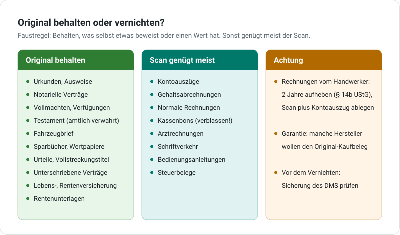

# Original behalten oder vernichten?

Du hast ein Papier eingescannt und im DMS abgelegt. Darf das Original jetzt weg? Oft ja, manchmal besser nicht. Diese Seite hilft dir bei der Entscheidung.

!!! warning "Keine Rechts- oder Steuerberatung"
    Hier stehen Faustregeln für einen privaten Haushalt. Im Einzelfall, besonders bei Streit, Erbe, Steuer oder Firma, frag bitte eine Beratungsstelle, deinen Steuerberater oder einen Anwalt.

{ .grafik }

## Die Faustregel

**Behalte das Original, wenn das Papier selbst etwas beweist oder einen Wert hat.** Sonst genügt meist der Scan.

Warum? Im Haushalt ist das eine einfache Abwägung:

- **Aufbewahren kostet fast nichts.** Ein Haushalt sammelt im Jahr ungefähr einen Schuhkarton Papier. Der steht in der Ecke und stört niemanden.
- **Fehlt das Original, kann es teuer werden.** Das kommt selten vor, aber dann richtig: Garantiefall, Streit mit dem Handwerker, Erbschaft.

Deshalb gilt: **Im Zweifel behalten.** Mit der [Kiste je Jahr](#die-kiste-je-jahr) ist das kein Aufwand.

## Original behalten

- Urkunden (Geburt, Heirat, Scheidung) und Ausweise
- Notarielle Verträge und Unterlagen zu Haus, Wohnung, Grundstück
- Vollmachten, Patientenverfügung, Betreuungsverfügung
- Testament, am besten in amtlicher Verwahrung beim Nachlassgericht
- Fahrzeugbrief (Zulassungsbescheinigung Teil II)
- Sparbücher und Wertpapiere
- Urteile und Vollstreckungstitel
- Unterschriebene Verträge, bei denen es Streit geben könnte
- Policen von Lebens- und Rentenversicherungen, auch nach der Auszahlung
- Rentenunterlagen (Arbeitsverträge, Nachweise zur Sozialversicherung), bis der Rentenbescheid da ist

**Warum der Scan hier nicht reicht:** Ein Scan ist vor Gericht keine Urkunde. Wer mit einem unterschriebenen Papier etwas beweisen will, muss im Streitfall grundsätzlich das Original vorlegen ([§ 420 ZPO](https://www.gesetze-im-internet.de/zpo/__420.html)). Ein Scan wird dann nur „frei gewürdigt“, und das ist im Zweifel weniger wert.

## Scan genügt meist

- Kontoauszüge
- Gehaltsabrechnungen, wenn du sie mit dem Konto abgeglichen hast
- Normale Rechnungen und Quittungen. Heb sie mindestens drei Jahre auf, gerechnet ab Ende des Jahres. So kannst du eine unberechtigte Mahnung abwehren.
- Kassenbons. Die sind oft auf Thermopapier und **verblassen**. Hier ist der Scan sogar besser als das Original.
- Arztrechnungen
- Schriftverkehr, Briefe, Mitteilungen
- Bedienungsanleitungen
- Belege für die Steuererklärung. Du reichst sie nicht mehr ein, musst sie aber auf Nachfrage vom Finanzamt vorlegen können. Dafür genügt in aller Regel ein guter Scan.

## Achtung

- **Rechnungen von Handwerkern an Haus oder Wohnung** musst du als Privatperson **zwei Jahre** aufbewahren ([§ 14b UStG](https://www.gesetze-im-internet.de/ustg_1980/__14b.html)). Die Frist beginnt mit dem Ende des Jahres, in dem die Rechnung ausgestellt wurde. Erlaubt sind die Rechnung, ein Zahlungsbeleg oder eine andere beweiskräftige Unterlage. Lege deshalb **Scan und Kontoauszug zusammen** in derselben Mappe ab. Bei Mängeln am Bau gilt meist eine Verjährung von fünf Jahren. Die Landesarchive empfehlen Eigentümern und privaten Vermietern deshalb, Handwerkerrechnungen **sechs Jahre** aufzuheben. Mit der [Kiste je Jahr](#die-kiste-je-jahr) kostet das kaum etwas.
- **Garantie und Gewährleistung:** Manche Hersteller verlangen für die Garantie den **Original-Kaufbeleg**. Heb ihn für die Gewährleistung mindestens zwei Jahre auf, bei längerer Garantie entsprechend länger.
- **Vor dem Vernichten die Sicherung prüfen.** Ein Scan nützt nur, wenn er nicht mit der Festplatte verloren geht. Frag deinen Administrator, ob die [Sicherung des DMS](https://motom001.github.io/dms/admin/aktuell/sicherung/) läuft und wann sie zuletzt geprüft wurde.

## Auch wenn du das Original behältst – das DMS hilft

### Originale sicher wegschließen

Was im Original bleiben muss, also Urkunden, Reisepass, notarielle Verträge, Fahrzeugbrief, Sparbücher, kann in ein **Bankschließfach** oder einen feuerfesten Dokumententresor. Dort ist es vor Brand, Wasser und Einbruch geschützt. Den Inhalt kannst du trotzdem jederzeit im DMS lesen.

- Was du im Alltag brauchst, zum Beispiel Personalausweis und Führerschein, bleibt natürlich zu Hause.
- **Nicht ins Schließfach** gehört, was im Notfall sofort gebraucht wird: Vorsorgevollmacht, Patientenverfügung, Betreuungsverfügung. An das Schließfach kommt man nur zu den Öffnungszeiten der Bank und ohne Vollmacht gar nicht.
- Frag bei deiner Bank nach, wie weit der Inhalt des Schließfachs versichert ist. Der Schutz ist oft begrenzt.

### Die Kiste je Jahr

Für Papiere, die du nur eine Zeit lang aufheben musst, brauchst du keinen Ordner. Das sind zum Beispiel Handwerkerrechnungen (zwei Jahre) oder Kaufbelege für die Gewährleistung.

1. Einscannen und im DMS ablegen.
2. Das Papier einfach der Reihe nach in eine **Kiste mit der Jahreszahl** legen, zum Beispiel „Kiste 2026“.
3. Ist die Frist für alles darin vorbei, kommt die Kiste als Ganzes weg. Nach der gesetzlichen Frist dürften Handwerkerrechnungen aus „Kiste 2026“ also Ende 2028 weg; wer der Empfehlung der Archive folgt, wartet bis Ende 2032. Bitte schreddern oder zu einer Aktenvernichtung bringen, denn darin stehen persönliche Daten.

Brauchst du doch einmal ein Original, findest du es im DMS. Am Datum siehst du, in welcher Kiste es liegt.

!!! tip "Bald: wo das Original liegt"
    Geplant sind **Ablageorte** ([#168](https://github.com/motom001/dms/issues/168)). Dann zeigt jede Mappe im Feld *Verbleib Originaldokumente*, wo das Papier ist: „Kiste 2026“, „Bankschließfach Sparkasse“ oder „vernichtet“. Kiste und Schließfach sind einfach weitere Ablageorte.

## Für Selbständige und Unternehmen

!!! note "Hier gelten strengere Regeln"
    Wer ein Gewerbe hat oder freiberuflich arbeitet, muss Belege meist **acht oder zehn Jahre** aufbewahren und darf Papier nur nach einem **festgelegten Ablauf** vernichten (GoBD). Bei vielen Belegen geht es dann nicht mehr um das einzelne Blatt, sondern um den Ablauf: Wer scannt, wie wird geprüft, wann wird vernichtet? Große Firmen orientieren sich dafür oft an der Technischen Richtlinie *TR-RESISCAN* des BSI.

    Im DMS helfen dabei der [Archivmodus](https://motom001.github.io/dms/admin/aktuell/archiv/) und die [Vorlage Verfahrensdokumentation](https://motom001.github.io/dms/admin/aktuell/verfahrensdokumentation/). Sprich den Ablauf auf jeden Fall mit deinem Steuerberater ab.

## Quellen

- Verbraucherzentrale Niedersachsen: [Aufbewahrungsfristen – kann das weg?](https://www.verbraucherzentrale-niedersachsen.de/wissen/vertraege-reklamation/kundenrechte/aufbewahrungsfristen-kann-das-weg-120019)
- Niedersächsisches Landesarchiv und Sächsisches Staatsarchiv: [Handreichung für die Archivierung zuhause (PDF, bei der Verbraucherzentrale)](https://www.verbraucherzentrale.de/sites/default/files/2023-06/handreichung-private-archivierung.pdf)
- [§ 14b Umsatzsteuergesetz](https://www.gesetze-im-internet.de/ustg_1980/__14b.html): Aufbewahrung von Rechnungen
- [§ 420 Zivilprozessordnung](https://www.gesetze-im-internet.de/zpo/__420.html): Vorlegung von Urkunden

*Stand: Oktober 2026.*
