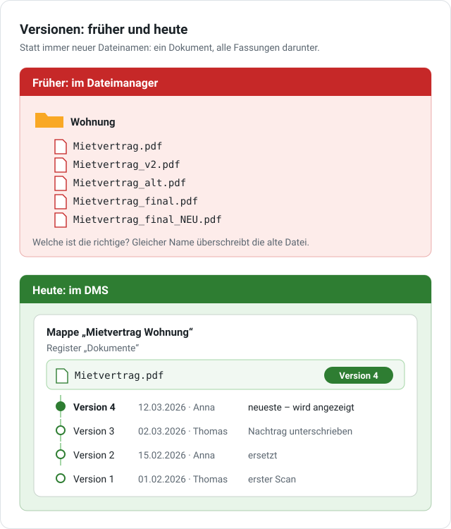

# Versionen verstehen

Im Dateimanager auf dem PC kennst du das: Legst du eine Datei mit demselben Namen ab, ist die alte weg. Deshalb hängen viele etwas an den Namen – `_v2`, `_alt`, `_final`, ein Datum. Nach ein paar Monaten weiß niemand mehr, welche Datei die richtige ist.

Im DMS musst du nichts mehr umbenennen. Ein Dokument bleibt **ein** Dokument, und jede neue Fassung wird eine neue **Version** davon. Die alten Fassungen bleiben darunter liegen.

{ .grafik }

!!! info "Nur wo die Versionierung eingeschaltet ist"
    Versionen gibt es in Registern, in denen ein Administrator die **Versionierung** eingeschaltet hat. Ob das so ist, siehst du am Knopf **Ersetzen** neben einem Dokument. Fehlt er, gibt es dort keine Versionen – oder du darfst die Mappe nur lesen.

## Eine neue Fassung ablegen

Kommt zum Mietvertrag ein unterschriebener Nachtrag, ein neuer Scan oder eine korrigierte Rechnung:

1. Öffne die Mappe und das Register mit dem Dokument.
2. Klicke neben dem Dokument auf **Ersetzen** und wähle die neue Datei.
3. Fertig – ohne **Mappe speichern**. Am Dokument steht jetzt **Version 2** (bzw. die nächste Nummer).

Die Mappe zeigt immer die **neueste** Version. Die alte ist nicht weg, sie liegt darunter. Der neue Dateiname darf anders sein, auch der Dateityp – aus `Kassenbon.jpg` darf `Kassenbon.pdf` werden.

**Lädst du eine Datei mit gleichem Namen** einfach hoch, fragt das DMS nach: Willst du sie **als neue Version** speichern (vorausgewählt) oder **als eigenes Dokument mit Zähler**, z. B. `Rechnung (2).pdf`? Ohne Versionierung lautet die Frage stattdessen: eigenes Dokument mit Zähler oder **altes Dokument löschen und neues hochladen** – dann ist das alte endgültig weg.

## Ältere Versionen ansehen, herunterladen, zurückholen

Ein Klick auf **Version 3** am Dokument zeigt alle Versionen: wann sie gespeichert wurde, von wem, woher sie kam, Dateiname und Größe.

- **Ansehen** (↗) öffnet eine ältere Version, ohne etwas zu ändern.
- **Herunterladen** speichert sie auf deinem Gerät.
- **Zurückholen** macht eine ältere Version wieder zur aktuellen: Sie wird als **neue, höchste** Version übernommen – aus Version 1 wird z. B. Version 4. Die Versionen dazwischen bleiben stehen; du kannst also jederzeit wieder zurück.

In der [Historie](zusammenarbeit.md#historie) der Mappe steht jede neue Version, z. B. „Version 3 (ersetzt Kassenbon.jpg)“ oder „Version 1 zurückgeholt“.

## Was du wissen solltest

- **Die Suche** findet Text nur in der aktuellen Version.
- **Begrenzte Zahl:** Ein Administrator kann einstellen, dass nur die letzten soundso viele Versionen bleiben. Ältere löscht das DMS dann von selbst; sie lassen sich nicht mehr zurückholen.
- **Dokument löschen** entfernt es mit **allen** Versionen. Hat es ältere Versionen, fragt das DMS vorher nach und nennt ihre Zahl. Es kommt mit allen Versionen in den [Papierkorb](ablage.md#papierkorb) und lässt sich von dort zurückholen.
- **Im Archivmodus** (Aufbewahrungspflicht) lassen sich Dokumente vor Fristende nicht löschen; eine neue Fassung legst du dort als neue Version ab.

## Version des Dokuments oder Version des DMS?

Das Wort „Version“ begegnet dir an zwei Stellen:

| | Version eines Dokuments | Version des DMS |
| --- | --- | --- |
| Was ist das? | eine Fassung einer Datei in einer Mappe | der Stand des Programms selbst, z. B. 0.73 |
| Wo steht es? | am Dokument: **Version 3** | unter [Neu in dieser Version](neu.md) und bei der Hilfe |
| Wer ändert es? | du, mit **Ersetzen** oder **Zurückholen** | ein Administrator, mit einem Update |

Ein Update des DMS ändert nichts an deinen Dokumenten und ihren Versionen.

Mehr zu Dokumenten allgemein: [Dokumente](dokumente.md#versionen).
