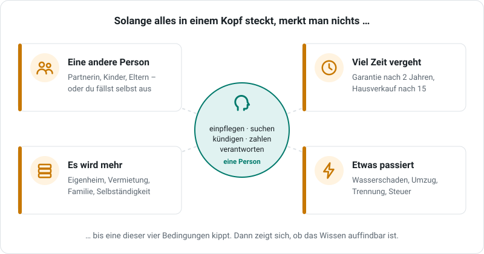
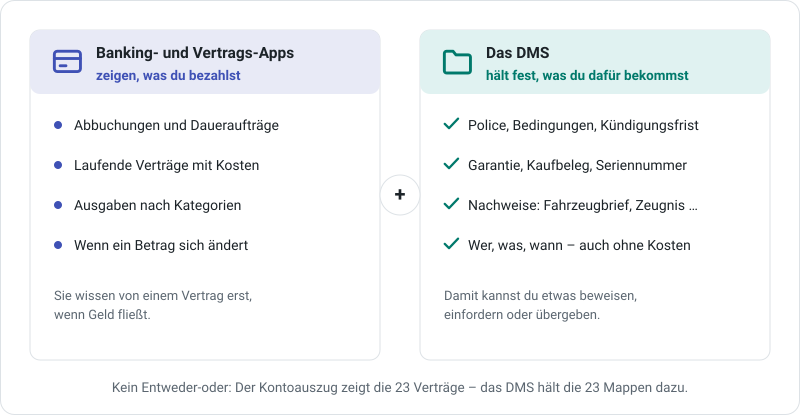
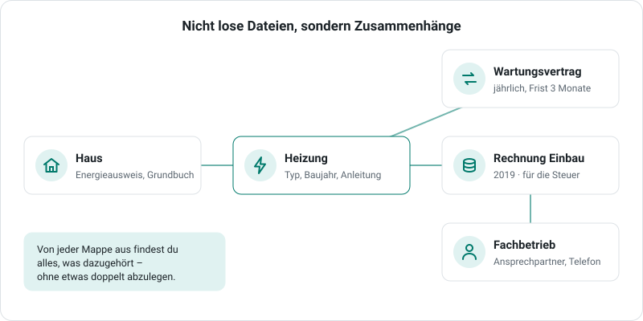
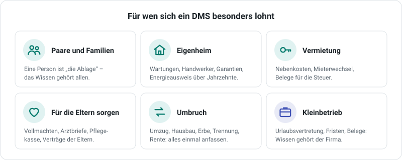
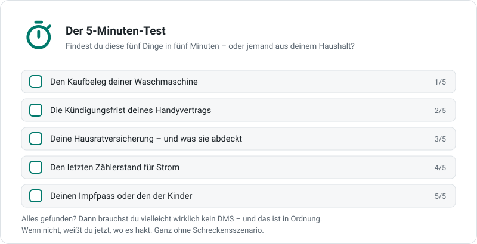

# Wofür ein DMS?

„Ich vergesse doch nie eine Rechnung, und meine Verträge kündige ich rechtzeitig.“ Gut möglich, dass das stimmt. Diese Seite will dich nicht vom Gegenteil überzeugen und auch keine Angst machen. Sie zeigt, **wann** ein DMS einen Unterschied macht – und lädt dich zu einem kleinen Selbstcheck ein.

## Warum man das Problem oft nicht spürt

Bei den meisten Menschen ist eine einzige Person alles zugleich: Sie legt ab, sucht, zahlt, kündigt und trägt die Verantwortung. Das Wissen steckt in **einem Kopf** – und solange das so bleibt, funktioniert es oft erstaunlich gut.

{ .grafik }

Spürbar wird es erst, wenn eine dieser Bedingungen kippt:

- **Eine andere Person** muss etwas finden oder entscheiden – die Partnerin, die Kinder, du für deine Eltern. Oder du selbst bist einmal nicht greifbar.
- **Viel Zeit vergeht** – die Garantie nach zwei Jahren, die Handwerkerrechnung beim Hausverkauf nach fünfzehn.
- **Es wird mehr** – Eigenheim, Vermietung, Familie, Selbständigkeit.
- **Etwas passiert** – ein Wasserschaden, ein Umzug, eine Trennung, die Steuererklärung. Dann braucht man vieles auf einmal.

## Was du bezahlst – und was du dafür bekommst

Banking- und Vertrags-Apps sind praktisch: Sie zeigen, wohin dein Geld fließt, und erkennen laufende Verträge an den Abbuchungen. Ein DMS ersetzt sie nicht – es kümmert sich um die andere Hälfte.

{ .grafik }

Eine App sieht einen Vertrag erst, wenn Geld fließt. Vieles, was im Alltag zählt, kostet aber gar nichts oder nur einmal:

- **Rechte:** Garantie, Gewährleistung, was deine Versicherung genau abdeckt, Widerrufsfrist.
- **Nachweise:** Kaufvertrag und Fahrzeugbrief, Energieausweis, Zeugnisse, Urkunden, Impfpass, Vollmachten.
- **Bedingungen:** Kündigungsfrist, Mindestlaufzeit, Selbstbeteiligung, Kundennummer, Ansprechpartner.
- **Dinge:** Welche Heizung im Keller steht, wann sie gewartet wurde und von wem.

Kurz: **Der Kontoauszug zeigt, was du bezahlst. Der Aktenordner zeigt, was du dafür bekommst** – und lässt dich etwas beweisen, einfordern oder an jemand anderen übergeben.

## Nicht lose Dateien, sondern Zusammenhänge

Ein DMS ist mehr als ein Ordner voller PDFs. Im DMS hängen die Dinge zusammen, wie im echten Leben: Das Haus hat eine Heizung, die Heizung einen Wartungsvertrag und eine Rechnung vom Einbau, die Rechnung einen Fachbetrieb.

{ .grafik }

Wenn der Fachbetrieb anruft, siehst du mit einem Klick alles, was du mit ihm zu tun hattest. Wenn die Heizung streikt, findest du Anleitung, Wartungsvertrag und Garantie an einer Stelle. Wie das im DMS heißt, steht unter [Die Idee: Mappen statt Ordner](index.md#die-idee-mappen-statt-ordner).

## Was du davon hast – ganz ohne Notfall

{ .grafik }

- **Kopf frei.** Fristen, Nummern und Ablageorte musst du dir nicht mehr merken. Das DMS [erinnert](eingang.md#erinnern) dich rechtzeitig an Fristen und zeigt, was ansteht.
- **Zeit.** Die Belege für die Steuererklärung oder die Unterlagen für die Versicherung findest du in Sekunden – auch im Text der Dokumente ([Suchen](ablage.md#suchen)).
- **Rechte nutzen.** Du forderst die Garantie ein, weil der Kaufbeleg da ist. Du setzt Handwerkerkosten ab, weil die Rechnung auffindbar ist. Du wechselst den Stromanbieter, weil du weißt, wann es geht.
- **Teilen statt erklären.** Deine Partnerin, die Kinder oder deine Eltern sehen selbst nach, statt dich zu fragen – jeder genau das, was er sehen soll ([Benutzer und Rollen](benutzer-und-rollen.md)).

Und deine Unterlagen liegen **bei dir**, auf deinem eigenen Gerät – nicht bei einem Anbieter, der sie auswertet.

## Für wen es sich besonders lohnt

{ .grafik }

| Lebenslage | Was das DMS dort leistet |
|---|---|
| **Paare und Familien** | Das Wissen hängt nicht an der einen Person, die „die Ablage“ ist. |
| **Eigenheim** | Wartungen, Handwerker, Garantien und Nachweise über Jahrzehnte – am Haus und an jedem Gerät. |
| **Vermietung** | Nebenkosten, Mieterwechsel und Belege für die Steuer an einem Ort. |
| **Für die Eltern sorgen** | Vollmachten, Arztbriefe, Pflegekasse und Verträge der Eltern – für alle Geschwister sichtbar. |
| **Umbruch** | Umzug, Hausbau, Erbe, Trennung, Rente: Wenn man ohnehin alles einmal anfassen muss, legt man es gleich ordentlich ab. |
| **Kleinbetrieb** | Urlaubsvertretung, Fristen, Aufbewahrung und Belege für den Steuerberater: Das Wissen gehört der Firma, nicht einer Person. |

!!! note "Ehrlich gesagt"
    Wer allein lebt, zur Miete wohnt, wenige Verträge hat und alles im Kopf behält, braucht vielleicht wirklich kein DMS – ein Ordner im Regal reicht dann. Ein DMS lohnt sich, sobald **andere** mitwissen sollen oder **viel Zeit** zwischen Ablegen und Brauchen liegt.

## Der 5-Minuten-Test

{ .grafik }

Stell dir eine Uhr auf fünf Minuten und suche diese fünf Dinge. Noch aufschlussreicher: Bitte jemanden aus deinem Haushalt, sie zu finden.

## Selbstcheck: Wo hakt es?

Zehn Fragen, ehrlich beantwortet. Es gibt kein „Bestanden“ – nur Hinweise, wo dir ein DMS Arbeit abnehmen kann. Deine Antworten bleiben in deinem Browser; nichts wird gespeichert oder gesendet.

1. Findest du den Kaufbeleg deines teuersten Haushaltsgeräts in zwei Minuten?
   *Im DMS liegt der Beleg an der Mappe des Geräts – mit Kaufdatum und Garantie. Ein Garantiefall ist dann eine Sache von Sekunden.*
2. Weißt du, bis wann du deinen Handy- oder Stromvertrag kündigen kannst?
   *Trägst du die Kündigungsfrist am Vertrag ein, erinnert dich das DMS rechtzeitig – nicht, um zu kündigen, sondern damit du in Ruhe vergleichen kannst.*
3. Weiß außer dir jemand, welche Versicherungen ihr habt und wo die Policen liegen?
   *Im DMS sehen die Menschen in deinem Haushalt selbst nach – jeder genau das, was er sehen soll.*
4. Weißt du, was deine Hausrat- oder Haftpflichtversicherung genau abdeckt?
   *Die Police mit ihren Bedingungen liegt an der Mappe der Versicherung; die Volltextsuche findet darin z. B. „Fahrrad“ oder „Glas“.*
5. Liegen die Belege fürs letzte Steuerjahr – Handwerker, Spenden, Arztkosten – an einem Ort?
   *Eine Sicht wie „Steuer 2025“ sammelt alle passenden Mappen von selbst, ohne dass du sie doppelt ablegst.*
6. Könntest du sagen, wann Heizung oder Auto zuletzt gewartet wurden – und von wem?
   *Heizung, Wartungsvertrag, Rechnungen und Fachbetrieb hängen im DMS zusammen; die nächste Wartung steht als Frist darin.*
7. Findest du wichtige Nachweise wie Fahrzeugbrief, Zeugnisse, Urkunden oder Impfpass sofort?
   *Ein Scan oder Foto im DMS ersetzt das Original nicht – aber du weißt immer, was es gibt und wo das Original liegt.*
8. Wissen die Beteiligten, wo Vollmachten oder wichtige Vereinbarungen in eurer Familie liegen?
   *Das DMS kann solche Unterlagen gezielt für bestimmte Personen sichtbar machen – zum Beispiel für die Geschwister, wenn ihr euch gemeinsam um die Eltern kümmert.*
9. Wüsstest du bei einem Umzug, wen du alles über die neue Adresse informieren musst?
   *Alle Vertragspartner stehen im DMS als eigene Mappen – mit Kundennummer und Kontakt. Die Liste ist schon da.*
10. Kannst du Kundennummer und Ansprechpartner deiner Verträge nennen, ohne im E-Mail-Postfach zu suchen?
    *Kundennummer, Ansprechpartner und der letzte Schriftwechsel stehen direkt am Vertragspartner.*

Wenn du an mehreren Stellen „Mit Suchen“ oder „Nein“ gewählt hast, ist das kein Versäumnis – so geht es fast allen. Ein guter Anfang ist meist **ein** Bereich: die Versicherungen, das Auto oder die Steuerbelege. Wie du die erste Mappe anlegst, steht unter [Erste Schritte](erste-schritte.md).
