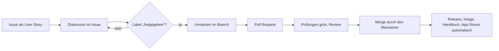

# Mitmachen beim DMS

Schön, dass du mitmachen möchtest! Das DMS ist ein kleines Projekt mit einem Maintainer ([motom001](https://github.com/motom001)). Damit Beiträge zusammenpassen und nichts umsonst gebaut wird, gilt eine einfache Arbeitsweise.

**Issues und Pull Requests sind auf Deutsch oder Englisch willkommen.** Für englischsprachige Mitwirkende gibt es [README](https://github.com/motom001/dms/blob/main/README.en.md), [CONTRIBUTING](https://github.com/motom001/dms/blob/main/CONTRIBUTING.en.md) und [SECURITY](https://github.com/motom001/dms/blob/main/SECURITY.en.md) auf Englisch; die Issue-Vorlagen sind zweisprachig.

## So läuft es

1. **Alles beginnt mit einem Issue**, geschrieben als User Story: *„Als … möchte ich …, damit …“* und mit Akzeptanzkriterien als Checkliste. Das gilt für Wünsche wie für Fehler. Vorlage: [Neues Issue](https://github.com/motom001/dms/issues/new/choose). Schreib dazu, **für wen** der Wunsch ist: für welche der [Personas](personas.md), von der Einsteiger-Familie bis zum Großunternehmen.
2. **Diskutiert wird im Issue**, bis klar ist, was gebaut wird und was nicht.
3. **Umgesetzt wird nur, was das Label `freigegeben` trägt.** Dieses Label vergibt allein der Maintainer. Ohne Freigabe wird ein Pull Request nicht gemergt, auch wenn er gut ist. Frag lieber im Issue nach, bevor du loslegst.
4. **Pull Request** mit `Closes #…`, Tests, angepasstem Handbuch und Release-Notizen (siehe [Beitrag einreichen](beitrag.md)).
5. **Gemergt wird nur vom Maintainer.** Danach entstehen Release, Image, Handbuch und die Einträge in den App-Stores von selbst (siehe [Release](release.md)).

!!! info "Warum das Label nur vom Maintainer kommt"
    Das DMS verwaltet Verträge, Ausweise und Steuerunterlagen von Familien. Jede Funktion muss dauerhaft gepflegt, dokumentiert und in Sicherung und Wiederherstellung bedacht werden. Die Freigabe ist der Moment, in dem der Maintainer sagt: Das passt ins Produkt, und ich kann es langfristig tragen. Ein Workflow entfernt das Label wieder, falls es jemand anderes setzt.

!!! note "Für wen wir bauen"
    Im Kern baut das DMS für Haushalte: Lena, die Einsteigerin, Jonas mit dem Handy und Markus mit seinem NAS. Steht eine Funktion für Firmen im Konflikt mit Einfachheit für diese drei, gewinnen die drei. Mehr dazu, und wie sich das ändern kann: [Für wen wir bauen](personas.md).

## Wo du helfen kannst

- **Fehler melden**, am besten mit **Werkbank → Technik → Übersicht für GitHub kopieren**.
- **Anleitungen prüfen und bebildern**, z. B. für [Synology, QNAP, UGREEN, TrueNAS oder Unraid](https://motom001.github.io/dms/installieren/aktuell/), wenn du so ein Gerät hast.
- **Issues mit dem Label `good first issue`**: kleine, gut abgegrenzte Aufgaben.
- **Übersetzungen** sind noch nicht geplant. Oberfläche und Handbuch sind deutsch.

## Lizenz

Das DMS steht unter der [Apache-2.0](https://github.com/motom001/dms/blob/main/LICENSE) (bis einschließlich 0.92.0: AGPL-3.0). Mit einem Beitrag stellst du ihn unter dieselbe Lizenz. Keine echten Dokumente oder persönlichen Daten committen, nur Code und Beispieldaten.
