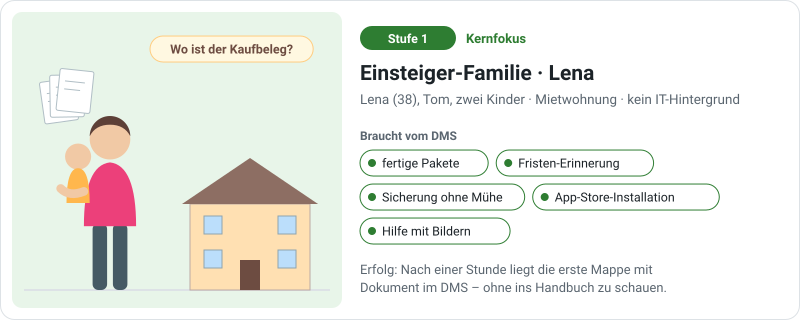
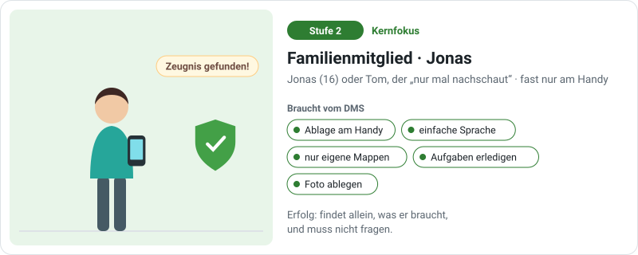
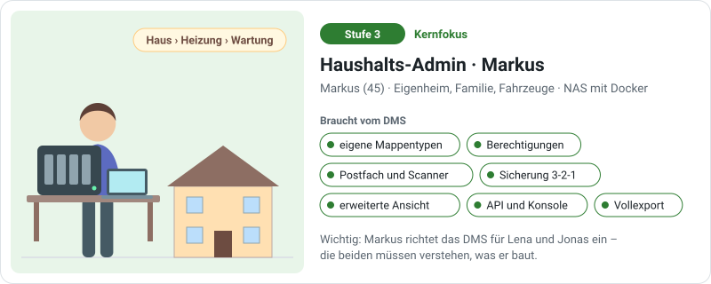
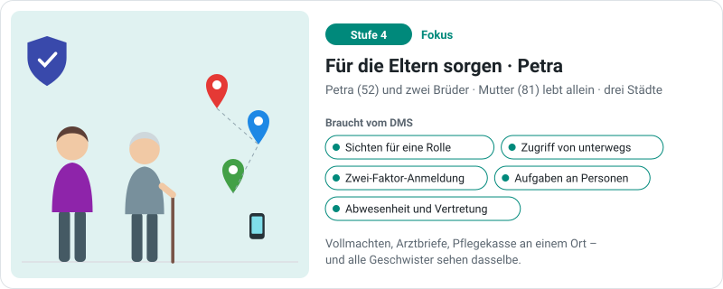
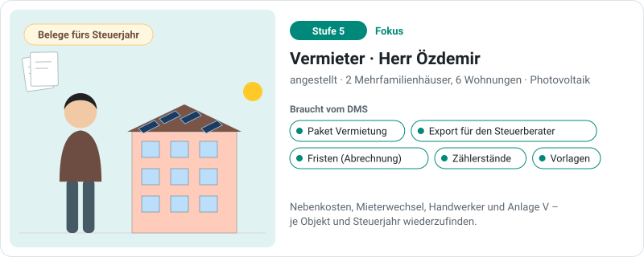
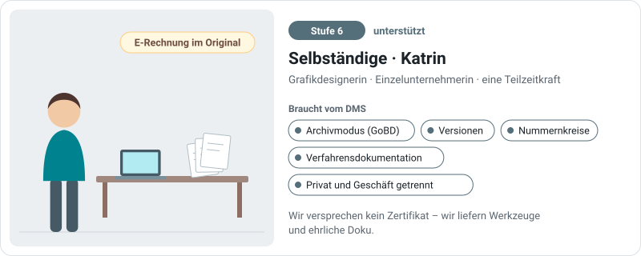
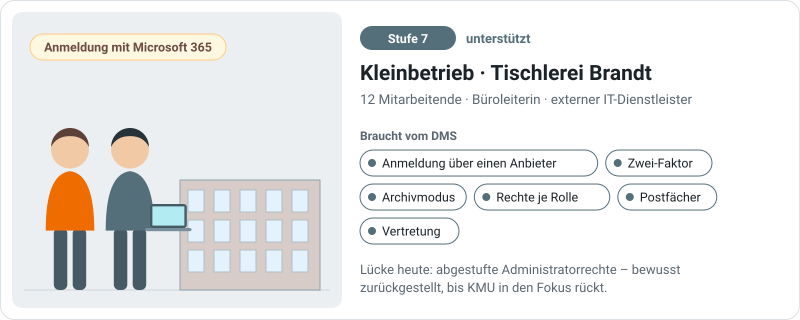
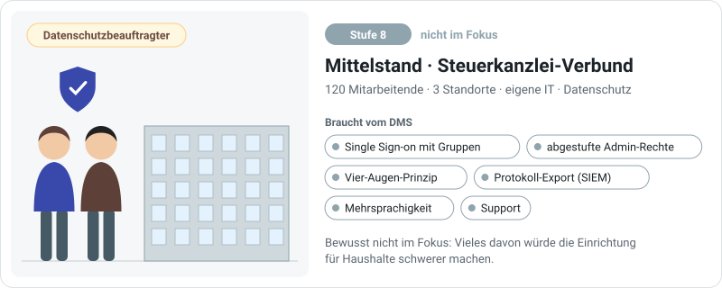
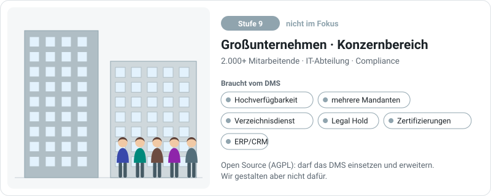

# Für wen wir bauen

Das DMS soll Menschen helfen, die Informationen ihres Lebens zu ordnen. Damit Begriffe, Voreinstellungen und neue Funktionen zusammenpassen, richten wir uns nach **neun Personas**: erfundene, aber typische Menschen, vom kleinen Haushalt bis zum Konzern. Die Namen sind nur Merkhilfen.

**Stand:** 31.10.2026 (DMS 0.73.6). Der Fokus ist eine bewusste Entscheidung des Maintainers. Er kann sich verschieben, zum Beispiel in Richtung Kleinbetrieb, und wird regelmäßig geprüft. Änderungen stehen unten unter [Fokus-Entscheidungen](#fokus-entscheidungen).

## Die Skala

| Stufe | Persona | Größe | Wer administriert | Fokus Stand heute |
|---|---|---|---|---|
| 1 | Einsteiger-Familie (Lena) | 2–4 Personen | die Einsteigerin selbst | **Kernfokus** |
| 2 | Familienmitglied (Jonas) | – | wird administriert | **Kernfokus** |
| 3 | Haushalts-Admin (Markus) | 2–5 Personen | er selbst, gern | **Kernfokus** |
| 4 | Für die Eltern sorgen (Petra) | 3–6 Personen in mehreren Haushalten | eine Person aus der Familie | **Fokus** |
| 5 | Vermieter (Herr Özdemir) | 1–2 Personen, 2–6 Wohnungen | er selbst | **Fokus** |
| 6 | Selbständige (Katrin) | 1–3 Personen | sie selbst oder ein Bekannter | unterstützt |
| 7 | Kleinbetrieb (Tischlerei Brandt) | 5–50 Personen | externer IT-Dienstleister oder Büroleitung | unterstützt |
| 8 | Mittelstand (Steuerkanzlei-Verbund) | 50–250 Personen | eigene IT | nicht im Fokus |
| 9 | Großunternehmen (Konzernbereich) | 250+ Personen | IT-Abteilung | nicht im Fokus |

**So ist das gemeint:**

- **Kernfokus:** Danach richten wir Begriffe, Voreinstellungen und Abläufe aus.
- **Fokus:** Diese Menschen sollen sich ohne Umwege gut zurechtfinden.
- **Unterstützt:** Funktionen dafür gibt es oder sind geplant, aber nur, wenn sie die Stufen 1–3 nicht komplizierter machen.
- **Nicht im Fokus:** Wir verhindern es nicht, gestalten aber nicht dafür.

**Warum dieser Schnitt?**

- Das DMS ist als **Haushalts-DMS** entstanden: Mappen statt Ordner, Sicherung mit Notfallblatt, Installation über die App-Stores von Heimservern.
- Für Kleinbetriebe gibt es schon einiges (Archivmodus, Vorlage Verfahrensdokumentation, Zwei-Faktor, Anmeldung über einen Anbieter, Konsole). Das soll nutzbar sein, aber **nicht die Richtung bestimmen**.
- Mittelstand und Konzern setzen Dinge voraus, die das DMS heute nicht hat. Viele davon würden die Einrichtung für Stufe 1 schwerer machen.

## Die Entscheidungsregel

!!! tip "Im Zweifel gewinnen Stufe 1–3"
    Steht eine Funktion für größere Organisationen im Konflikt mit Einfachheit für Lena, Jonas und Markus, gewinnen Stufe 1–3. Fortgeschrittenes kommt in den **Expertenmodus** oder bleibt aus, bis man es einschaltet.

    Ein Beispiel ist **Werkbank anpassen**: Neue Installationen starten mit der Vorlage „Haushalt“ und zeigen nur die Bereiche, die ein Haushalt zum Einrichten und Sichern braucht. Weitere Bereiche blendet man mit der Vorlage „Organisation“ oder „Alles“ ein.

Bei jeder neuen Idee, jedem Issue und jeder größeren Änderung fragen wir:

1. **Für wen** ist das (Stufe 1–9)?
2. **Geht es zu weit** für unseren Fokus? Macht es die Stufen 1–3 komplizierter?
3. **Müssen wir etwas zurückdrehen**, das schon gebaut ist?
4. **Passt es zum Fokus**, oder wollen wir den Fokus bewusst verschieben?

Daraus folgt außerdem:

- **Voreinstellungen** richten sich nach Lena. Markus darf alles ändern.
- **Begriffe** prüfen wir mit den Augen von Lena und Jonas.
- **Risiken** wägen wir je Persona ab. Was im Konzern selten und teuer ist, kann im Haushalt häufig und harmlos sein, und umgekehrt.

## Zielgruppen an Issues

Jedes Issue bekommt ein oder mehrere **Labels mit dem Namen der Zielgruppe**: `Einsteiger-Familie`, `Familienmitglied`, `Haushalts-Admin`, `Für die Eltern sorgen`, `Vermieter`, `Selbständige`, `Kleinbetrieb`, `Mittelstand`, `Großunternehmen`. Wenn du einen Wunsch einreichst, schreib dazu, für wen er ist. Die Labels setzt der Maintainer.

## Die Personas

### 1 · Einsteiger-Familie – Lena (Kernfokus)

- **Wer:** Lena (38) und Tom (40), zwei Kinder, Mietwohnung. Lena kümmert sich um den Papierkram. Kein IT-Hintergrund.
- **Ziele:** Belege schnell wiederfinden, keine Fristen verpassen, Tom soll selbst nachschauen können.
- **Typische Aufgaben:** Post fotografieren und zuordnen, eine Mappe für einen Vertrag anlegen, nach „Waschmaschine“ suchen, an eine Kündigungsfrist erinnern lassen, die Sicherung einschalten.
- **Stolpersteine:** Fachwörter, zu viele Einstellungen, die Frage „Was muss ich überhaupt einrichten?“, Angst, Daten zu verlieren.
- **Braucht:** fertige Pakete statt leerer Werkbank, gute Voreinstellungen, eine Einrichtung in wenigen Schritten, Hilfe mit Bildern, eine Sicherung, die einfach läuft.
- **Erfolg:** Nach einer Stunde liegt die erste Mappe mit Dokument im DMS, die Sicherung läuft, und Lena musste nichts nachschlagen.

Lena **administriert selbst**: Sie ist Einsteigerin und Administratorin zugleich.

### 2 · Familienmitglied – Jonas (Kernfokus)

- **Wer:** Jonas (16), Lenas Sohn, oder Tom, der „nur mal nachschaut“. Nutzt fast nur das Handy.
- **Ziele:** schnell etwas finden, ein Foto ablegen, eine Aufgabe wie „Bitte unterschreiben“ erledigen.
- **Stolpersteine:** Fachwörter wie Mappentyp oder Trefferliste, leere Listen ohne Erklärung, Fehlermeldungen in Technik-Sprache.
- **Braucht:** eine Ablage, die am Handy gut geht, einfache Sprache, nur die eigenen Mappen, „Das darfst du nicht sehen – frag Lena“ statt Fehlercode.
- **Erfolg:** findet allein, was er braucht.

### 3 · Haushalts-Admin – Markus (Kernfokus)

- **Wer:** Markus (45), IT-affin, betreibt ein NAS mit Docker. Eigenheim, Familie, ein paar Fahrzeuge.
- **Ziele:** eigene Mappentypen bauen (Haus → Heizung → Wartungsvertrag → Rechnung), Rechte für die Familie, Zugriff von unterwegs, Postfach und Scanner anbinden, Sicherung nach 3-2-1.
- **Typische Aufgaben:** Mappentypen und Ansichten entwerfen, Berechtigungen testen, Pakete installieren, Updates einspielen, Protokoll lesen.
- **Stolpersteine:** versteckte Einstellungen, fehlende Technik-Doku, Updates, die etwas ändern, ohne es zu sagen.
- **Braucht:** Expertenmodus, Administratorhandbuch, API und Konsole, Release-Notizen, Vollexport.

Markus richtet das DMS **für Lena und Jonas** ein. Was er baut, müssen die beiden verstehen.

### 4 · Für die Eltern sorgen – Petra und Geschwister (Fokus)

- **Wer:** Petra (52) und ihre zwei Brüder kümmern sich um die Mutter (81), die allein lebt. Drei Haushalte in verschiedenen Städten.
- **Ziele:** Vollmachten, Arztbriefe, Pflegekasse und Verträge der Mutter an einem Ort. Alle Geschwister sehen dasselbe. Keine Frist (Pflegegrad, Widerspruch) geht verloren.
- **Stolpersteine:** den Zugriff von außen sicher einrichten, sensible Gesundheitsdaten, wer was ändern darf.
- **Braucht:** Ansichten für eine Rolle („Mutter“), Aufgaben an Personen, Zwei-Faktor-Anmeldung, Zugriff von unterwegs, Abwesenheit und Vertretung.

### 5 · Vermieter – Herr Özdemir (Fokus)

- **Wer:** angestellt, besitzt zwei kleine Mehrfamilienhäuser mit sechs Wohnungen und einer Photovoltaik-Anlage. Ein Steuerberater macht die Anlage V.
- **Ziele:** Nebenkostenabrechnung, Mieterwechsel, Handwerkerrechnungen je Objekt, Belege je Steuerjahr, Zählerstände.
- **Stolpersteine:** der Aufbau der Mappentypen (Objekt → Wohnung → Mietvertrag → Mieter), der Export im richtigen Format.
- **Braucht:** ein Paket „Vermietung“, Export für den Steuerberater, Fristen, Vorlagen.

### 6 · Selbständige – Katrin (unterstützt)

- **Wer:** Grafikdesignerin, Einzelunternehmerin, eine Teilzeitkraft.
- **Ziele:** Eingangs- und Ausgangsrechnungen, Kundenverträge, E-Rechnungen im Original aufbewahren, Belege für den Steuerberater.
- **Besonderheit:** Für sie gilt die GoBD. Privates und Geschäftliches liegen oft im selben DMS.
- **Braucht:** Archivmodus, Versionen, Nummernkreise, Vorlage Verfahrensdokumentation, Trennung von Privat und Geschäft über Ansichten und Rechte.
- **Stolperstein:** „Ist das GoBD-konform?“ Wir versprechen kein Zertifikat, sondern liefern Werkzeuge und ehrliche Doku.

### 7 · Kleinbetrieb – Tischlerei Brandt (unterstützt)

- **Wer:** 12 Mitarbeitende, Büroleiterin Frau Brandt, ein externer IT-Dienstleister betreut Microsoft 365 und einen kleinen Server.
- **Ziele:** Aufträge, Rechnungen, Lieferanten, Personalakten (streng getrennt), Urlaubsvertretung, Post per E-Mail und Scanner.
- **Administration:** Der IT-Dienstleister installiert und aktualisiert, die Büroleiterin pflegt Benutzer und Mappentypen.
- **Braucht:** Anmeldung über Microsoft 365, Zwei-Faktor, Archivmodus, Rechte je Rolle, Postfächer, Vertretung.
- **Lücke heute:** abgestufte Administratorrechte. Bewusst zurückgestellt, bis Kleinbetriebe in den Fokus rücken.

### 8 · Mittelstand – Steuerkanzlei-Verbund (nicht im Fokus)

- **Wer:** 120 Mitarbeitende, drei Standorte, eigene IT, ein Datenschutzbeauftragter.
- **Erwartet:** Single Sign-on mit Gruppen, abgestufte Administratorrechte, Vier-Augen-Prinzip, Protokoll-Export (SIEM), Test- und Produktivsystem, Mehrsprachigkeit, Support mit Reaktionszeiten.
- **Warum nicht im Fokus:** Vieles davon würde Oberfläche und Einrichtung für Stufe 1–3 schwerer machen. Support mit Reaktionszeiten passt nicht zu einem kleinen Open-Source-Projekt.

### 9 · Großunternehmen – Konzernbereich (nicht im Fokus)

- **Wer:** 2.000+ Mitarbeitende, IT-Abteilung, viele Administratoren mit getrennten Zuständigkeiten, Compliance.
- **Erwartet zusätzlich:** Hochverfügbarkeit, mehrere Mandanten in einer Installation, Rechte aus dem Verzeichnisdienst, Aufbewahrungsrichtlinien, Zertifizierungen, Anbindung an ERP und CRM.
- **Haltung:** Das DMS steht unter der AGPL. Ein Konzern darf es einsetzen und erweitern. Wir gestalten aber nicht dafür.

## Fokus-Entscheidungen

| Datum | Entscheidung | Begründung |
|---|---|---|
| 31.10.2026 | Kernfokus Stufe 1–3, Fokus 4–5, unterstützt 6–7, nicht im Fokus 8–9 | Entstanden als Haushalts-DMS. Funktionen für Firmen nur, wenn sie Stufe 1–3 nicht komplizierter machen. |
| 31.10.2026 | Abgestufte Administratorrechte zurückgestellt ([#282](https://github.com/motom001/dms/issues/282)) | betrifft Stufe 7–9, erst wenn Kleinbetriebe in den Fokus rücken |
| 31.10.2026 | Zielgruppen als Labels an den Issues | alle, die mitentwickeln, arbeiten mit demselben Fokus |
| 31.10.2026 | Werkbank anpassen: neue Installationen starten mit der Vorlage „Haushalt“ ([#281](https://github.com/motom001/dms/issues/281)) | Stufe 1–3 sehen nur, was sie brauchen; bestehende Installationen zeigen weiter alles |

Die Grafiken entstehen mit `docs/handbuch/werkzeuge/personas_grafiken.py`. Wer eine Persona ändert, ändert dort die Karte mit.
