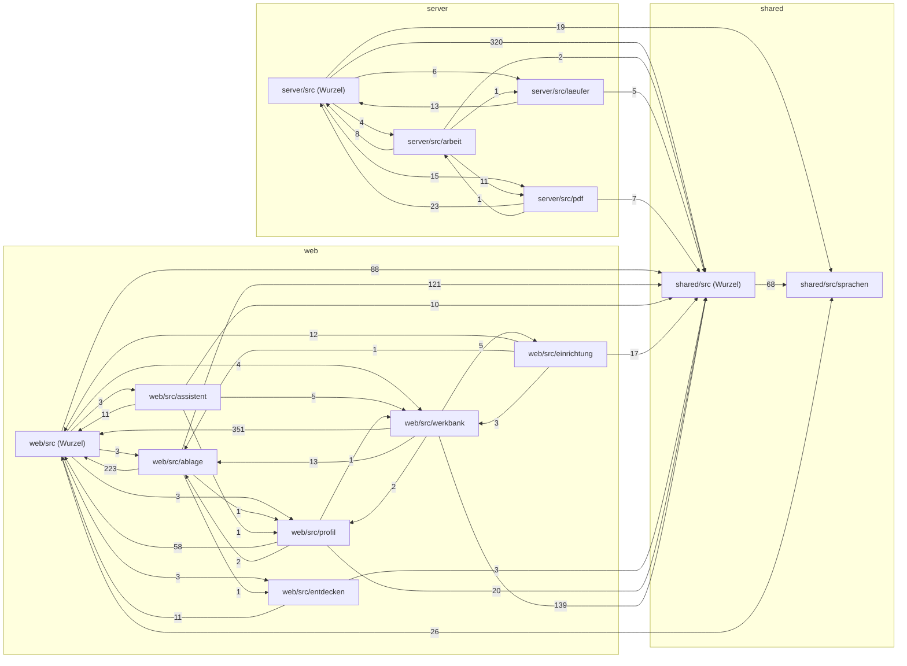

# Stil und Abhängigkeiten

Zwei Werkzeuge prüfen den Code, bevor er nach `main` kommt (#899): **ESLint** für typische Programmierfehler und zu große Funktionen, **dependency-cruiser** für die Richtung der Importe zwischen Server, Oberfläche und gemeinsamem Code. Beide laufen in der CI im Job **stil**, parallel zu den Tests, und beide kennen den **Bestand**: Was beim Einführen schon gegen eine Regel verstieß, steht in einer Liste und meldet sich nicht. Neuer Code ist dagegen voll streng – jeder Verstoß ist ein Fehler.

## Befehle { #befehle }

| Befehl | Was |
| --- | --- |
| `npm run lint` | ESLint über Server, Tests, Oberfläche und `shared` (mit Typinformation, gut eine Minute); `npm run lint -- --quiet` zeigt nur Fehler |
| `npx eslint server/src/dienst.ts` | nur einzelne Dateien – schneller beim Arbeiten |
| `npm run lint:abh` | Abhängigkeiten prüfen (dependency-cruiser, wenige Sekunden) |
| `npm run lint:zaehlen` | Bestandslisten gegen `main` zählen – genau die Prüfung der CI |
| `npm run lint:umtragen` | nach einem Umzug: Bestand neu schreiben, Verwaistes streichen, dann zählen |
| `npm run lint:farben` | [keine festen Farben](#farben) außerhalb von `tokens.css` |
| `node .github/werkzeuge/fachordner-pruefen.mjs` | jeder Fachordner mit `*.dienst.ts` hat `index.ts` und `README.md` (#1072) |
| `npm run abhaengigkeitsbild` | [Abhängigkeitsbild](#abhaengigkeitsbild) neu erzeugen |

Die Werkzeuge sind feste Versionen (ohne `^`) unter `devDependencies` im Wurzelordner und kommen nicht ins Image: Dort installiert `npm ci --omit=dev --workspace server` nur die Laufzeit-Pakete des Servers.

## Regeln und Werte { #regeln }

Die Einstellungen stehen in `eslint.config.js` (flache Konfiguration, ESLint 10). Grundlage sind die empfohlenen Regeln von ESLint und `typescript-eslint`; dazu kommen:

| Regel | Wert | Ziel |
| --- | --- | --- |
| `max-params` | 5 | 4 |
| `complexity` | 20 (Fehler) | 10 |
| `ablago/komplexitaet-hinweis` | 15 (nur Warnung) | – |
| `max-lines-per-function` | 60; in `*.tsx` 150; in `*.routen.ts` je Handler 60 | – |
| `max-lines` | 400 je Datei | – |
| `max-depth` | 4 | – |
| `@typescript-eslint/no-floating-promises` | an | – |
| `@typescript-eslint/no-misused-promises` | an | – |
| `@typescript-eslint/no-explicit-any` | an | – |
| `react-hooks/rules-of-hooks`, `react-hooks/exhaustive-deps` | an (Oberfläche) | – |
| `ablago/bausteine` | an (`web/src/**/*.tsx` außer `web/src/bausteine/`) | – |
| `ablago/knopf-farben` | an (`web/src/**/*.tsx`) | – |
| `@eslint-community/eslint-comments/require-description` | an | – |

Längen zählen ohne Leerzeilen und Kommentare – Erklärungen im Code sollen nichts kosten.

- **Zwei Schwellen für die Komplexität:** Eine Regel hat in ESLint nur eine Stufe. `ablago/komplexitaet-hinweis` ist dieselbe Regel `complexity` noch einmal, mit 15 als Warnung; die CI zeigt die Warnungen nur für die Dateien, die ein Pull Request ändert, als Anmerkung an der Zeile. Die eigenen Regeln stehen in `.github/werkzeuge/eslint-ablago.mjs`.
- **Routendateien (`*.routen.ts`, #960):** Gemessen wird jeder Handler für sich. Ausgenommen ist nur die äußere Registrierfunktion – eine exportierte Funktion auf oberster Ebene, die die Handler einträgt. Stehen die Routen als Liste auf Modulebene, zählt ohnehin jeder Handler einzeln.
- **Tests (`server/test/`):** ohne `max-lines` und `max-lines-per-function`, sonst dieselben Regeln. `test()`, `describe()` und `it()` aus `node:test` gelten nicht als „nicht abgewartet“.
- **Werkzeug-Skripte** (`.github/werkzeuge/*.mjs`, `server/test/*.mjs`, `web/rauchtest/*.mjs`): nur die Grundregeln von ESLint, ohne Typinformation.
- **Bausteine (`ablago/bausteine`, #968):** In der Oberfläche ist ein rohes `<button>` ein Fehler – dafür gibt es `Knopf`. `<input>`, `<select>` und `<textarea>` sind es, wenn sie nicht in `Feld`, `HakenFeld` oder `FeldGruppe` stehen. Ausgenommen sind unsichtbare Eingaben (`type="hidden"`, `type="file"`) und die Bausteine selbst unter `web/src/bausteine/`. Für Fälle, die die Bausteine bewusst nicht abdecken (Suchfeld ohne sichtbare Beschriftung, Eingabe in einer Tabellenzelle, siehe [Feld](bausteine-feld.md#wann)), gilt eine Ausnahme mit Begründung im Code. Der Bestand beim Einschalten steht in `eslint-suppressions.json`.
- **Farbe am Knopf (`ablago/knopf-farben`, #1210):** Farbklassen über `className` an `Knopf`, `KnopfLink` und `knopfAussehen()` – `gefahr`, `gefahr-rand`, `gruen`, `primaer` – sind ein Fehler; die Farbe kommt aus der Art ([Leitsätze](bausteine.md#leitsaetze)). Geprüft werden alle festen Texte im Wert, auch in Bedingungen und Vorlagen-Texten. Der Bestand beim Einschalten (18 Stellen) steht in `eslint-suppressions.json` und wird in #1211–#1215 abgebaut. Test: `.github/werkzeuge/eslint-ablago.test.mjs`.
- **Promises in der Oberfläche:** `onClick={async () => …}` meldet `no-misused-promises`, denn React wartet nicht auf das Promise und ein Fehler bliebe unbemerkt. Besser: `onClick={() => void speichern()}` mit eigenem `try`/`catch` in `speichern`.

### Ausnahmen im Code { #ausnahmen-im-code }

Muss eine Regel an einer Stelle wirklich weichen, dann mit Begründung nach `--`:

```ts
}, [fehlend]); // eslint-disable-line react-hooks/exhaustive-deps -- Namen nur nachladen, wenn sich die Liste ändert
```

Ohne Begründung, ohne Regelname (`/* eslint-disable */`) oder ohne Wirkung ist die Ausnahme selbst ein Fehler.

## Bestand: umtragen ja, hinzufügen nein { #bestand }

Beim Einführen standen rund 700 Verstöße im Code – vor allem zu komplexe Funktionen, unbenutzte Variablen und `async` in Ereignissen der Oberfläche. Sie stehen in **`eslint-suppressions.json`** (Datei → Regel → Anzahl, erzeugt mit `eslint --suppress-all`). ESLint meldet sie nicht, solange eine Datei nicht mehr Verstöße einer Regel hat als dort eingetragen. Ebenso stehen die Kreisläufe, die es schon gab, in **`.dependency-cruiser-known-violations.json`**.

Für beide Listen gilt: **Die Gesamtzahl darf nie steigen.** Die CI zählt sie im Pull Request gegen den Stand der Basis (`.github/werkzeuge/ausnahmen-zaehlen.mjs`) und scheitert, wenn eine Zahl wächst.

- **Umtragen ist erlaubt.** Zieht eine Funktion in eine andere Datei um (etwa beim Teilen von `routen.ts`), wandert ihr Eintrag mit: `npm run lint:umtragen` schreibt die Listen neu und streicht, was nicht mehr vorkommt. Die Summe bleibt gleich – die Prüfung ist grün.
- **Hinzufügen nicht.** Neuer oder geänderter Code, der eine Regel verletzt, wird korrigiert, nicht eingetragen. `lint:umtragen` würde ihn zwar aufnehmen, aber dann wächst die Zahl, und die CI meldet, bei welcher Regel.
- **Neue Regel einschalten.** Wer eine Regel neu einführt, friert nur ihren Bestand ein: `npx eslint --suppress-rule <regel> --pass-on-unpruned-suppressions .` – die übrigen Einträge bleiben, wie sie sind. Die Gesamtzahl steigt dabei, ohne dass Code schlechter wird; `ausnahmen-zaehlen.mjs` rechnet die neue Regel deshalb heraus und zeigt ihren Bestand als „neue Regel … (Ausgangspunkt)“. Neu ist eine Regel, wenn sie in der Basis keinen Eintrag hat **und** ihr Name (`'regel'`) in `eslint.config.js` neu dazukommt – so steht sie sichtbar im Pull Request, und eine längst eingeschaltete Regel ohne Bestand lässt sich nicht still einfrieren. Ab dem nächsten Stand zählt ihr Bestand wie jeder andere.
- **Weniger ist willkommen.** Wer eine Funktion vereinfacht, kann die Liste mit `npx eslint --prune-suppressions .` gleich mit verkleinern – sonst erledigt das der Workflow unten.

### Aufräumen auf main { #aufraeumen }

Der Workflow **Bestandslisten aufräumen** (`.github/workflows/ausnahmen-aufraeumen.yml`) läuft nach jedem Push auf `main`: `eslint --prune-suppressions` streicht Einträge, die im Code nicht mehr vorkommen, dependency-cruiser schreibt seine Liste neu. Ändert sich etwas, legt er den Branch `ausnahmen-aufraeumen` an und öffnet einen Pull Request – oder aktualisiert den offenen.

Mit dem `GITHUB_TOKEN` angelegte Pull Requests starten nach einer Regel von GitHub keine Workflows; die Pflichtprüfungen fehlen dann. Darum: diesen Pull Request einmal **schließen und wieder öffnen** – dann laufen alle Prüfungen wie sonst. Eine Release-Notiz braucht er nicht, er ändert nur die beiden Listen.

## Farben aus Tokens { #farben }

Farben stehen nur in **`web/src/tokens.css`** (#966) – als Variablen mit sprechenden Namen, hell im Block `:root` und dunkel im Block `@media (prefers-color-scheme: dark)`. Der Dunkelmodus hat damit genau eine Stelle; auch die Designs (Werkbank → Designs, `web/src/design.ts`) lesen beide Blöcke aus dieser Datei und setzen nur ihre eigenen Primär- und Sekundärfarben darüber. In `styles.css`, `basis.css` und im Code der Oberfläche steht nie ein Farbwert, sondern immer `var(--name)`; halbtransparente Abstufungen entstehen mit `color-mix(in srgb, var(--name) 16%, transparent)`.

| Token | Wofür |
| --- | --- |
| `--grund`, `--flaeche`, `--senke`, `--tinte`, `--leise`, `--linie`, `--linie-stark` | Seite, Flächen, Schrift und Linien (`--linie-stark` für Trennlinien und Kartenränder) |
| `--rand-eingabe` | Rand von Eingaben, Auswahllisten und Farbwahl – mindestens 3:1 gegen `--flaeche` und `--senke` (WCAG 1.4.11, #1026) |
| `--akzent`, `--gruen`, `--schlecht`, `--warn` mit `-zart` und `-tinte` | Farbe, zarter Hintergrund, Schrift auf der vollen Farbe |
| `--verwaltung`, `--verwaltung-tinte` | roter Balken im Verwaltungsmodus |
| `--schatten-zart`, `--schatten`, `--schatten-stark`, `--schleier`, `--schleier-stark` | Schatten schwebender Flächen, Schleier hinter Dialogen |
| `--papier`, `--papier-auswahl`, `--papier-wort`, `--schwaerzung`, `--markierung-1` … `-6` | Dokumente und Markierungen darauf – bleiben auch im Dunkeln wie auf Papier |

Ein neuer Token bekommt immer einen hellen **und** einen dunklen Wert (oder bewusst denselben, wie beim Papier). Schrift auf ihrer Fläche muss in beiden Modi mindestens 4,5:1 erreichen, der Rand von Eingaben (`--rand-eingabe`) mindestens 3:1 gegen `--flaeche` und `--senke` – auch bei hohem Kontrast; `server/test/tokens.test.ts` rechnet das für die Paare nach.

**Prüfung:** `npm run lint:farben` (`.github/werkzeuge/farben-pruefen.mjs`) sucht in `web/src/**/*.css` außer `tokens.css` nach Hex-Werten, `rgb()`/`hsl()` & Co. und benannten Farben wie `white`, in `*.ts(x)` nach Farbwerten in Zeichenketten. Die CI führt sie im Job **stil** aus; jeder Fund ist ein Fehler. Ausnahmen brauchen einen Grund in derselben Zeile – `/* farbe-erlaubt: Druck ist immer schwarz auf weiß */` – oder, für ganze Dateien, einen Eintrag mit Grund in `AUSNAHMEN` im Skript (heute: `design.ts` mit den Werten für hohen Kontrast, die Beispielbelege der Stempel-Vorschau).

**Bausteine:** Wie Felder, Knöpfe und andere Teile der Oberfläche aussehen und sich verhalten, legen die Bausteine unter `web/src/bausteine/` fest – Seiten setzen sie zusammen, statt Abstände, Farben oder `aria`-Attribute selbst zu schreiben. Mehr unter [Gestaltung und Bausteine](bausteine.md).

## Abhängigkeiten zwischen den Teilen { #abhaengigkeiten-pruefen }

`.dependency-cruiser.cjs` legt fest, wer wen importieren darf (`npm run lint:abh`):

- **Keine Kreisläufe** zwischen Dateien (reine Typ-Importe zählen nicht).
- **`shared/`** importiert weder `server/` noch `web/` – der Code läuft in beiden.
- **`web/`** importiert nie `server/`, **`server/`** nie `web/`. Ausnahme: Tests unter `server/test/`.
- **Technik nur über `index.ts`:** die [PDF-Stelle](aufbau.md#pdf-stelle) `server/src/pdf/` (außer für `arbeit/vorgaenge.ts`, das die Vorgänge im Arbeiter-Faden ausführt) und `server/src/arbeit/`.
- **Fachordner** (#1072, eine Regel `fachordner` für alle, vorher je Ordner zwei): von außen nur über ihre `index.ts` – auch aus Tests –, und [Schichten](aufbau.md#schichten) nur abwärts. Die Schichten stehen zentral in `SCHICHTEN` (Kern 0, `zugriff` 1, `mappentypen`/`mappen`/`dokumente`/`berechtigungen`/`ereignisse` 2, alle übrigen 3, auch künftige), die Ordner ohne Fachlogik in `TECHNIK`. Der Kern importiert nur sich selbst, `shared/` und die Basis (`BASIS` in der Datei: Repo, Datenbank, Protokoll, Texte, Einstellungen, Dateien, Zähler, Fehler, Grenzen); höhere Schichten dazu tiefere Fachordner und die Werkzeuge (`WERKZEUGE`: `messung.ts`, `vektoren.ts`, seit #1075 die Technik der Dateien – `hochladen.ts`, `verkleinern.ts`, `dateiumwandlung.ts`, `archivfassung.ts`, `entsperren.ts`, `paketvolltext.ts` –, seit #1077 die Technik für Post, Ausgang und PDF bearbeiten – `pdfseiten.ts`, `graubild.ts`, `schwaerzen.ts`, `ausgabe.ts`, `export.ts`, `xlsx.ts`, `zip.ts`, `mail.ts` –, seit #1078 die Technik für Löschen und Datenschutz – `baum.ts`, `schriftstueck.ts`, `auskunft.ts`, `vollexport.ts`, `abruf.ts`, `passwort.ts`, `tresor.ts` –, `pdf/`, `arbeit/`) – nie `dienst.ts`. Routen (`*.routen.ts`) sind ausgenommen: `routen.ts` holt sie direkt, und sie dürfen den Dienst und ihren eigenen Fachordner einbinden. Siehe [Kern](aufbau.md#kern), [Rechte prüfen](aufbau.md#zugriff).
- **Hilfen der HTTP-Schicht nur in Routen** (#961, `routen-hilfen-nur-in-routen`): `http/routen-hilfen.ts` und `http/routen-kontext.ts` importieren nur `*.routen.ts` und `routen.ts`. Fachlogik bekommt den Benutzer übergeben, statt ihn selbst aus der Anfrage zu lesen (etwa mit `ich(a)`).
- **Tür und Beschreibung:** Jeder Fachordner mit `*.dienst.ts` braucht `index.ts` und eine von Hand geschriebene `README.md` (`.github/werkzeuge/fachordner-pruefen.mjs`, Job **stil**). Was in der README steht, prüft niemand; einen erzeugten Teil gibt es nicht.

### Abhängigkeitsbild { #abhaengigkeitsbild }

Das Bild zeigt die Importe auf **Ordner-Ebene**; die Zahl an einem Pfeil ist die Zahl der Importe. Dateien direkt unter `src/` stehen als „(Wurzel)“. `npm run abhaengigkeitsbild` erzeugt die Quelle `grafiken/abhaengigkeiten.mmd` neu und, wenn die Mermaid-CLI (`mmdc`) installiert ist, auch das Bild.

{ loading=lazy }
