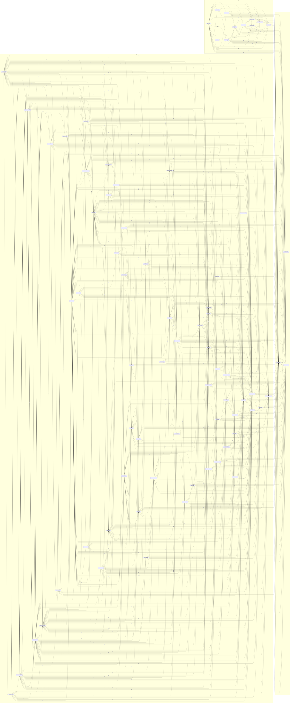

# Stil und Abhängigkeiten

Zwei Werkzeuge prüfen den Code, bevor er nach `main` kommt (#899): **ESLint** für typische Programmierfehler und zu große Funktionen, **dependency-cruiser** für die Richtung der Importe zwischen Server, Oberfläche und gemeinsamem Code. Beide laufen in der CI im Job **stil**, parallel zu den Tests, und beide kennen den **Bestand**: Was beim Einführen schon gegen eine Regel verstieß, steht in einer Liste und meldet sich nicht. Neuer Code ist dagegen voll streng – jeder Verstoß ist ein Fehler.

## Befehle { #befehle }

| Befehl | Was |
| --- | --- |
| `npm run format` | alle Dateien [formatieren](#formatierung) (Prettier; zwei Durchgänge, weil Prettier lange Methodenketten manchmal erst im zweiten fertig umbricht; zusammen gut zwei Minuten) |
| `npm run format:pruefen` | nur prüfen, ob alles formatiert ist – genau die Prüfung der CI |
| `npm run lint` | ESLint über Server, Tests, Oberfläche und `shared` (mit Typinformation, gut eine Minute); `npm run lint -- --quiet` zeigt nur Fehler |
| `npx eslint server/src/dienst/dienst.ts` | nur einzelne Dateien – schneller beim Arbeiten |
| `npm run lint:abh` | Abhängigkeiten prüfen (dependency-cruiser, wenige Sekunden) |
| `npm run lint:zaehlen` | Bestandslisten gegen `main` zählen – genau die Prüfung der CI |
| `npm run lint:umtragen` | nach einem Umzug: Bestand neu schreiben, Verwaistes streichen, dann zählen |
| `npm run lint:farben` | [keine festen Farben](#farben) außerhalb von `tokens.css` |
| `npm run lint:klassen` | [jede Klasse einmal und beim Besitzer](#klassen), keine ungenutzten Klassen, `z-index` nur als Stufe |
| `npm run lint:tot` | [toter Code](#toter-code): ungenutzte Dateien, Exporte und Abhängigkeiten (knip, wenige Sekunden) |
| `node .github/werkzeuge/fachordner-pruefen.mjs` | jeder Fachordner mit `*.dienst.ts` hat `index.ts` und `README.md` (#1072) |
| `npm run abhaengigkeitsbild` | [Abhängigkeitsbild](#abhaengigkeitsbild) neu erzeugen |

Die Werkzeuge sind feste Versionen (ohne `^`) unter `devDependencies` im Wurzelordner und kommen nicht ins Image: Dort installiert `npm ci --omit=dev --workspace server` nur die Laufzeit-Pakete des Servers.

## Formatierung { #formatierung }

Wie der Code aussieht – Einrückung, Umbrüche, Anführungszeichen, Kommas –, entscheidet **Prettier** (#1280), nicht der Autor. Reviews drehen sich so um den Inhalt. Prettier ist eine feste Version unter `devDependencies`; die CI prüft im Job **stil** mit `npm run format:pruefen`, ob jede Datei so aussieht, wie Prettier sie schreibt.

- **Einstellungen** in `.prettierrc.json`: Zeilenlänge 140, Einrückung 2 Leerzeichen, einfache Anführungszeichen (in JSX doppelte), Semikolons, Komma nach dem letzten Eintrag mehrzeiliger Listen. Vorlagen-Texte (`` `…` ``) bleiben unangetastet, auch eingebettetes CSS oder HTML.
- **Ausnahmen** in `.prettierignore`: Markdown, YAML, HTML und CSS (CSS bleibt bei „eine Regel je Zeile“, weil die [Farbprüfung](#farben) zeilenweise arbeitet), `package-lock.json`, erzeugte Dateien wie die Bestandslisten und Test-Fixtures, deren Bytes zählen (Signaturen, Prüfsummen, rohe PDF-Körper). Neue Fixtures dieser Art dort eintragen.
- **Sprachdateien** formatiert Prettier mit; `shared/test/sprachdateien-format.test.ts` stellt sicher, dass dabei jeder Wert gleich bleibt.
- **Editor**: In VS Code die Erweiterung *Prettier – Code formatter* (`esbenp.prettier-vscode`) mit `"editor.formatOnSave": true` und `"prettier.requireConfig": true`; sie nimmt das Prettier aus `node_modules`. In JetBrains-IDEs unter *Languages & Frameworks → Prettier* „Automatic Prettier configuration“ und „Run on save“. Ohne Editor-Anbindung vor dem Commit `npm run format`.
- **`git blame`**: Der eine Commit, der alles formatiert hat, steht in `.git-blame-ignore-revs` (Abschnitt „Formatierer“). GitHub überspringt ihn von selbst, lokal einmal `git config blame.ignoreRevsFile .git-blame-ignore-revs`.
- **Nachprüfbar**: Ein Formatier-Commit enthält nur die Ausgabe von Prettier. `bash .github/werkzeuge/formatierung-nachpruefen.sh <commit>` lässt Prettier auf dem Stand davor laufen und vergleicht – der Unterschied muss leer sein. Die CI macht das für jeden neuen Eintrag im Abschnitt „Formatierer“ (Bedingung Sicherheit). Ein späterer Formatier-Commit (etwa nach einem Update von Prettier) kommt genauso in diesen Abschnitt.

## Regeln und Werte { #regeln }

Die Einstellungen stehen in `eslint.config.js` (flache Konfiguration, ESLint 10). Grundlage sind die empfohlenen Regeln von ESLint und `typescript-eslint`; dazu kommen:

| Regel | Wert | Ziel |
| --- | --- | --- |
| `max-params` | 5 | 4 |
| `complexity` | 20 (Fehler) | 10 |
| `ablago/komplexitaet-hinweis` | 15 (nur Warnung) | – |
| `max-lines-per-function` | 105; in `*.tsx` 260; in `*.routen.ts` je Handler 105 | – |
| `max-lines` | 700 je Datei | – |
| `max-depth` | 4 | – |
| `@typescript-eslint/no-floating-promises` | an | – |
| `@typescript-eslint/no-misused-promises` | an | – |
| `@typescript-eslint/no-explicit-any` | an | – |
| `react-hooks/rules-of-hooks`, `react-hooks/exhaustive-deps` | an (Oberfläche) | – |
| `ablago/bausteine` | an (`web/src/**/*.tsx` außer `web/src/bausteine/`) | – |
| `ablago/knopf-farben` | an (`web/src/**/*.tsx`) | – |
| `@eslint-community/eslint-comments/require-description` | an | – |

Längen zählen ohne Leerzeilen und Kommentare – Erklärungen im Code sollen nichts kosten.

- **Zwei Schwellen für die Komplexität:** Eine Regel hat in ESLint nur eine Stufe. `ablago/komplexitaet-hinweis` ist dieselbe Regel `complexity` noch einmal, mit 15 als Warnung; die CI zeigt die Warnungen nur für die Dateien, die ein Pull Request ändert, als Anmerkung an der Zeile. Die eigenen Regeln stehen in `.github/werkzeuge/eslint-ablago.mjs`.
- **Routendateien (`*.routen.ts`, #960):** Gemessen wird jeder Handler für sich. Ausgenommen ist nur die äußere Registrierfunktion – eine exportierte Funktion auf oberster Ebene, die die Handler einträgt. Stehen die Routen als Liste auf Modulebene, zählt ohnehin jeder Handler einzeln.
- **Tests (`server/test/`, `web/test/`, `shared/test/`):** ohne `max-lines` und `max-lines-per-function`, sonst dieselben Regeln. `test()`, `describe()` und `it()` aus `node:test` gelten nicht als „nicht abgewartet“.
- **Werkzeug-Skripte** (`.github/werkzeuge/*.mjs`, `server/test/*.mjs`, `web/test/*.mjs`, `web/rauchtest/**/*.mjs`): nur die Grundregeln von ESLint, ohne Typinformation; die Rauchtests zusätzlich mit `max-lines` 700 je Datei (#1234). Für die Gestaltung begrenzt `npm run lint:farben` jede CSS-Datei unter `web/src/` auf 400 Zeilen, ebenfalls ohne Leerzeilen und Kommentare.
- **Bausteine (`ablago/bausteine`, #968):** In der Oberfläche ist ein rohes `<button>` ein Fehler – dafür gibt es `Knopf`. `<input>`, `<select>` und `<textarea>` sind es, wenn sie nicht in `Feld`, `HakenFeld` oder `FeldGruppe` stehen. Ausgenommen sind unsichtbare Eingaben (`type="hidden"`, `type="file"`) und die Bausteine selbst unter `web/src/bausteine/`. Für Fälle, die die Bausteine bewusst nicht abdecken (Suchfeld ohne sichtbare Beschriftung, Eingabe in einer Tabellenzelle, siehe [Feld](bausteine-feld.md#wann)), gilt eine Ausnahme mit Begründung im Code. Der Bestand beim Einschalten steht in `eslint-suppressions.json`.
- **Farbe am Knopf (`ablago/knopf-farben`, #1210):** Farbklassen über `className` an `Knopf`, `KnopfLink` und `knopfAussehen()` – `gefahr`, `gefahr-rand`, `gruen`, `primaer` – sind ein Fehler; die Farbe kommt aus der Art ([Leitsätze](bausteine.md#leitsaetze)). Geprüft werden alle festen Texte im Wert, auch in Bedingungen und Vorlagen-Texten. Der Bestand beim Einschalten (11 Stellen) steht in `eslint-suppressions.json` und wird in #1211–#1215 abgebaut. Test: `.github/werkzeuge/eslint-ablago.test.mjs`.
- **Promises in der Oberfläche:** `onClick={async () => …}` meldet `no-misused-promises`, denn React wartet nicht auf das Promise und ein Fehler bliebe unbemerkt. Besser: `onClick={() => void speichern()}` mit eigenem `try`/`catch` in `speichern`.

### Ausnahmen im Code { #ausnahmen-im-code }

Muss eine Regel an einer Stelle wirklich weichen, dann mit Begründung nach `--`:

```ts
}, [fehlend]); // eslint-disable-line react-hooks/exhaustive-deps -- Namen nur nachladen, wenn sich die Liste ändert
```

Ohne Begründung, ohne Regelname (`/* eslint-disable */`) oder ohne Wirkung ist die Ausnahme selbst ein Fehler. Kann [Prettier](#formatierung) die Stelle auf mehrere Zeilen umbrechen, besser ein Paar `/* eslint-disable regel -- Grund */` … `/* eslint-enable regel */` um die Anweisung – eine `-line`-Ausnahme gilt nur für ihre eine Zeile.

## Bestand: umtragen ja, hinzufügen nein { #bestand }

Beim Einführen standen rund 700 Verstöße im Code – vor allem zu komplexe Funktionen, unbenutzte Variablen und `async` in Ereignissen der Oberfläche. Sie stehen in **`eslint-suppressions.json`** (Datei → Regel → Anzahl, erzeugt mit `eslint --suppress-all`). ESLint meldet sie nicht, solange eine Datei nicht mehr Verstöße einer Regel hat als dort eingetragen. Ebenso standen die Kreisläufe, die es schon gab, in **`.dependency-cruiser-known-violations.json`** – seit #1278 (Schritt 5) ist dort keiner mehr; die Liste bleibt für andere Verstöße gegen die Regeln der Abhängigkeiten.

Für beide Listen – und für `knip-bestand.json` ([Toter Code](#toter-code)) – gilt: **Die Gesamtzahl darf nie steigen.** Die CI zählt sie im Pull Request gegen den Stand der Basis (`.github/werkzeuge/ausnahmen-zaehlen.mjs`) und scheitert, wenn eine Zahl wächst.

- **Umtragen ist erlaubt.** Zieht eine Funktion in eine andere Datei um (etwa beim Teilen von `routen.ts`), wandert ihr Eintrag mit: `npm run lint:umtragen` schreibt die Listen neu und streicht, was nicht mehr vorkommt. Die Summe bleibt gleich – die Prüfung ist grün.
- **Hinzufügen nicht.** Neuer oder geänderter Code, der eine Regel verletzt, wird korrigiert, nicht eingetragen. `lint:umtragen` würde ihn zwar aufnehmen, aber dann wächst die Zahl, und die CI meldet, bei welcher Regel.
- **Neue Regel einschalten.** Wer eine Regel neu einführt, friert nur ihren Bestand ein: `npx eslint --suppress-rule <regel> --pass-on-unpruned-suppressions .` – die übrigen Einträge bleiben, wie sie sind. Die Gesamtzahl steigt dabei, ohne dass Code schlechter wird; `ausnahmen-zaehlen.mjs` rechnet die neue Regel deshalb heraus und zeigt ihren Bestand als „neue Regel … (Ausgangspunkt)“. Neu ist eine Regel, wenn sie in der Basis keinen Eintrag hat **und** ihr Name (`'regel'`) in `eslint.config.js` neu dazukommt – so steht sie sichtbar im Pull Request, und eine längst eingeschaltete Regel ohne Bestand lässt sich nicht still einfrieren. Ab dem nächsten Stand zählt ihr Bestand wie jeder andere.
- **Grenze ändern.** Ändert sich der Wert einer Regel in `eslint.config.js` (so mit dem [Formatierer](#formatierung) die Längen ×1,75, #1280), gilt ihr Bestand ebenfalls neu: `ausnahmen-zaehlen.mjs` rechnet die Regel heraus und zeigt „Grenze von … geändert (neuer Ausgangspunkt)“. Geändert heißt: Die Zeilen, die die Regel nennen, unterscheiden sich ohne Kommentare und Leerraum von der Basis.
- **Weniger ist willkommen.** Wer eine Funktion vereinfacht, kann die Liste mit `npx eslint --prune-suppressions .` gleich mit verkleinern – sonst erledigt das der Workflow unten.

### Aufräumen auf main { #aufraeumen }

Der Workflow **Bestandslisten aufräumen** (`.github/workflows/ausnahmen-aufraeumen.yml`) läuft nach jedem Push auf `main`: `eslint --prune-suppressions` streicht Einträge, die im Code nicht mehr vorkommen, dependency-cruiser schreibt seine Liste neu. Ändert sich etwas, legt er den Branch `ausnahmen-aufraeumen` an und öffnet einen Pull Request – oder aktualisiert den offenen.

Mit dem `GITHUB_TOKEN` angelegte Pull Requests starten nach einer Regel von GitHub keine Workflows; die Pflichtprüfungen fehlen dann. Darum: diesen Pull Request einmal **schließen und wieder öffnen** – dann laufen alle Prüfungen wie sonst. Eine Release-Notiz braucht er nicht, er ändert nur die beiden Listen.

## Farben aus Tokens { #farben }

Farben stehen nur in **`web/src/tokens.css`** (#966) – als Variablen mit sprechenden Namen, hell im Block `:root` und dunkel im Block `@media (prefers-color-scheme: dark)`. Der Dunkelmodus hat damit genau eine Stelle; auch die Designs (Werkbank → Designs, `web/src/design.ts`) lesen beide Blöcke aus dieser Datei und setzen nur ihre eigenen Primär- und Sekundärfarben darüber. In `web/src/stile/*.css`, `basis.css` und im Code der Oberfläche steht nie ein Farbwert, sondern immer `var(--name)`; halbtransparente Abstufungen entstehen mit `color-mix(in srgb, var(--name) 16%, transparent)`.

| Token | Wofür |
| --- | --- |
| `--grund`, `--flaeche`, `--senke`, `--tinte`, `--leise`, `--linie`, `--linie-stark` | Seite, Flächen, Schrift und Linien (`--linie-stark` für Trennlinien und Kartenränder) |
| `--rand-eingabe` | Rand von Eingaben, Auswahllisten und Farbwahl – mindestens 3:1 gegen `--flaeche` und `--senke` (WCAG 1.4.11, #1026) |
| `--akzent`, `--gruen`, `--schlecht`, `--warn` mit `-zart` und `-tinte` | Farbe, zarter Hintergrund, Schrift auf der vollen Farbe |
| `--verwaltung`, `--verwaltung-tinte` | roter Balken im Verwaltungsmodus |
| `--schatten-zart`, `--schatten`, `--schatten-stark`, `--schleier`, `--schleier-stark` | Schatten schwebender Flächen, Schleier hinter Dialogen |
| `--papier`, `--papier-auswahl`, `--papier-wort`, `--schwaerzung`, `--markierung-1` … `-6` | Dokumente und Markierungen darauf – bleiben auch im Dunkeln wie auf Papier |

Ein neuer Token bekommt immer einen hellen **und** einen dunklen Wert (oder bewusst denselben, wie beim Papier). Schrift auf ihrer Fläche muss in beiden Modi mindestens 4,5:1 erreichen, der Rand von Eingaben (`--rand-eingabe`) mindestens 3:1 gegen `--flaeche` und `--senke` – auch bei hohem Kontrast; `web/test/tokens.test.ts` rechnet das für die Paare nach.

**Prüfung:** `npm run lint:farben` (`.github/werkzeuge/farben-pruefen.mjs`) sucht in `web/src/**/*.css` außer `tokens.css` nach Hex-Werten, `rgb()`/`hsl()` & Co. und benannten Farben wie `white`, in `*.ts(x)` nach Farbwerten in Zeichenketten. Die CI führt sie im Job **stil** aus; jeder Fund ist ein Fehler. Ausnahmen brauchen einen Grund in derselben Zeile – `/* farbe-erlaubt: Druck ist immer schwarz auf weiß */` – oder, für ganze Dateien, einen Eintrag mit Grund in `AUSNAHMEN` im Skript (heute: `design.ts` mit den Werten für hohen Kontrast, die Beispielbelege der Stempel-Vorschau).

**Bausteine:** Wie Felder, Knöpfe und andere Teile der Oberfläche aussehen und sich verhalten, legen die Bausteine unter `web/src/bausteine/` fest – Seiten setzen sie zusammen, statt Abstände, Farben oder `aria`-Attribute selbst zu schreiben. Mehr unter [Gestaltung und Bausteine](bausteine.md).

## Klassen einmal und beim Besitzer { #klassen }

Jede Klasse der Gestaltung steht **auf oberster Ebene in genau einer Datei**, der ihres Besitzers (#1270): Eine Klasse, die nur ein Bereich setzt, steht in dessen Datei (`web/src/ablage/ablage-*.css`, `web/src/werkbank/werkbank*.css`, `web/src/einrichtung/einrichtung.css` …), samt ihrer Handy-Regeln; eine Klasse, die mehrere Bereiche setzen, in `web/src/stile/gemeinsam-*.css`; eine Klasse eines Bausteins in seinem Modul. „Auf oberster Ebene“ heißt: Sie ist die erste Klasse eines Selektors – `.kachel:hover` gehört `.kachel`, `.blatt .kachel` gehört `.blatt`. So überschreibt niemand unbemerkt eine Regel an anderer Stelle. Globale Knopf-Klassen gibt es nicht mehr: Eine Umgebung passt einen Knopf über `[data-knopf="…"]` an, ein Etikett über `[data-etikett]`.

`z-index` hat **Stufen** in `tokens.css` (`--ebene-innen`, `--ebene-leiste`, `--ebene-kopf`, `--ebene-menue`, `--ebene-blatt`, `--ebene-panel` …); ein Teil, das über seiner eigenen Stufe liegen muss, schreibt `calc(var(--ebene-blatt) + 1)`.

**Prüfung:** `npm run lint:klassen` (`.github/werkzeuge/klassen-pruefen.mjs`) meldet eine Klasse in mehr als einer Datei, eine Klasse, die die Oberfläche nirgends setzt (kein Wort in einer Zeichenkette unter `web/src`, bei Modulen kein `s.name`), und jeden `z-index` außer einer Stufe, `0`, `-1` und `auto`. Die CI führt sie im Job **stil** aus.

## Toter Code (knip) { #toter-code }

**knip** (#1286) sucht Dateien, die nirgends eingebunden sind, Exporte und Typen, die niemand importiert, und Pakete, die genutzt werden, aber nicht in der `package.json` ihres Bereichs stehen (oder umgekehrt). `npm run lint:tot` startet es über `.github/werkzeuge/knip-pruefen.mjs`; die CI macht dasselbe im Job **stil**.

- **Einstellung** in `knip.jsonc`: die Bereiche (Wurzel mit Werkzeugen, Handbuch-Skripten und `shared/`, `server`, `web`, `web/rauchtest`) mit ihren Einstiegspunkten. Was knip nicht selbst findet – ein Skript, das eine HTML-Seite lädt, eine Datei, die nur `tsc` prüft –, steht dort als Einstiegspunkt **mit Begründung**. Ebenso jede Ausnahme (`ignoreDependencies`, `ignoreBinaries`, etwa die Programme aus poppler und qpdf).
- **Dateien und Abhängigkeiten** haben keinen Bestand: Jeder Fund ist ein Fehler. Ein Paket, das ein Bereich nutzt, gehört mit genauer Version in seine eigene `package.json` – nicht „zufällig“ über ein anderes Paket.
- **Exporte und Typen** von heute stehen in **`knip-bestand.json`** (je Datei die Namen) und melden sich nicht. Ein neuer ungenutzter Export ist ein Fehler. Für die Liste gilt dasselbe wie oben: Die Zahl darf nicht steigen (`lint:zaehlen`); `npm run lint:tot -- --umtragen` schreibt sie nach einem Umzug neu. Einträge ohne Fund meldet der Lauf als Hinweis.
- Bevor du einen Export löschst, den knip meldet: kurz suchen, ob ihn das Handbuch, eine Vorlage oder ein Anker (`shared/entdecken/anker.yaml`) nennt. Die Merker `DMS_…_AB` (ab welcher Version ein Manifest-Feld gilt) bleiben, auch wenn der Code sie nicht liest.

## Abhängigkeiten zwischen den Teilen { #abhaengigkeiten-pruefen }

`.dependency-cruiser.cjs` legt fest, wer wen importieren darf (`npm run lint:abh`):

- **Keine Kreisläufe** zwischen Dateien (`kein-kreislauf`) – ein Kreis ist ein Fehler, er steht nicht im Bestand. Es zählen auch reine Typ-Importe (`import type`, `import('…').Typ`) – in `shared/src/` und `web/src/` seit #1278 (Schritt 5a), in `server/src/` seit Schritt 5b: Auch ein Kreis nur über Typen verklebt die Dateien – keine lässt sich ohne die andere lesen oder verschieben. Tests sind ausgenommen. Wie man einen Kreis auflöst:
    - **Form nach unten:** Typen, die mehrere Dateien teilen, in eine Datei, die nichts zurück einbindet – die Datei, die sie auswertet, holt sie von dort und reicht sie weiter, wo andere sie bisher von ihr holten. Beispiele: Die Angaben am Feld und am Mappentyp (Frist, „folgt aus“, Erkennung, Format, Aufbewahrung …) liegen in `shared/src/model/angaben.ts`, das Regelwerk in `model/regelwerk.ts`, die Beschriftungen in `model/beschriftungen.ts`; die Form der Automatisierungen in `shared/src/automatisierung-typen.ts`; die Rechte an einer Sicht bei der Sicht (`sichten/baum.ts`). Im Server die Form der Routen in `http/routen-typen.ts` (siehe unten), die IMAP-Verbindung in `post/postfach-typen.ts`, der Plan des Notfallblatts in `pdf/notfallblatt.ts`, Dateiname und Texterkennung der Dokumente in `dokumente/gemeinsam.ts` und der Anschluss eines Fachordners in seiner `anschluss.ts` (`aufgaben/`, `loeschen/`, `datenschutz/`).
    - **Zweite Tür:** Teile, die das Fachmodell selbst einbindet (Prüfregeln, Werte und Systemmappentypen nutzen etwa `beschriftung.ts`, `folgtaus.ts`, `tabelle.ts`, `verweisziele.ts`), nehmen das Modell aus `model/basis.ts` – der Form von Feld, Mappentyp und Mappe ohne Prüfregeln –, nicht aus `model/index.ts`. Alles aus `basis.ts` gibt es auch über `index.ts`.
    - **Schmaler Anschluss statt der ganzen Klasse:** Bekommt ein Teil seinen Besitzer herein (`new Historie(this)` im Kern), beschreibt er mit einer kleinen Schnittstelle, was er davon braucht (`HistorieAnschluss` in `server/src/kern/historie.ts`), statt die Klasse einzubinden. Ebenso nehmen Erkennung, Übersetzung, Fragen an die Ablage und die Postfächer nicht den ganzen `Dienst`, sondern je eine Schnittstelle mit den Teilen, die sie rufen (`ErkennungDienst` in `erkennung/erkennung-basis.ts`, `PostfachDienst` …; `Pick<Klasse, 'methode'>`).
    - **Teile beschreiben statt einbinden:** Rufen die Klassen eines Fachordners einander über `teile`, nennt jede nur die Teile, die sie ruft (`Pick<Klasse, …>` für Klassen weiter unten). Ruft eine Klasse fast alle anderen und rufen die anderen sie, beschreibt eine eigene Datei, was die anderen von ihr brauchen, und die Klasse erfüllt das (`aufgaben/vertretung-teil.ts`, `class AufgabenVertretung implements VertretungTeil`). Die volle Liste, die der Dienst zusammensetzt, steht ganz oben (`aufgaben/aufgaben-teile.ts`), den Anschluss hat der Ordner in `anschluss.ts`.
    - **Zustand neben die Oberfläche:** Hooks und Zustand, die Teile einer Seite teilen, in eine eigene Datei (`web/src/werkbank/paketeZustand.ts`, `betriebZustand.ts`, `web/src/erreichbarkeit.ts`); ein Kind beschreibt selbst, was es vom Elternteil bekommt (`PostfachStand.tsx`).
    - Gegenprobe: `npm run lint:abh` nennt den Kreis mit allen Dateien darauf.
- **`shared/`** importiert weder `server/` noch `web/` – der Code läuft in beiden.
- **`web/`** importiert nie `server/`, **`server/`** nie `web/` – auch die Tests unter `server/test/` nicht; Tests der Oberfläche stehen unter `web/test/` (#1282). Ausnahme: `shared/test/` prüft Sprachdateien und Gemeinsames über alle Teile hinweg.
- **Technik nur über `index.ts`:** die [PDF-Stelle](aufbau.md#pdf-stelle) `server/src/pdf/` (außer für `arbeit/vorgaenge.ts`, das die Vorgänge im Arbeiter-Faden ausführt) und `server/src/arbeit/`; das Repo `server/src/repo/` nur über seine drei `index.ts` (Schnittstelle, `pg/`, `speicher/`; `repo-nur-ueber-index`, #1278). Ebenso die Ordner in `shared/src/`, die früher eine Datei waren – das Fachmodell `model/`, `erkennung/`, `pakete/` und `sichten/` –, nur über ihre `index.ts` (`shared-ordner-nur-ueber-index`, #1278, Liste `SHARED_ORDNER`); die Importe heißen wie früher `…/shared/src/model` usw. Das Fachmodell hat eine zweite Tür, `model/basis.ts` (siehe oben, #1278, Schritt 5). Drei Ausnahmen, damit über die Tür kein Kreis entsteht: `feldformate.ts` holt die IBAN-Prüfung aus `erkennung/angaben.ts`, das Fachmodell den Typ `Feldbedingung` aus `sichten/bedingungen.ts` und die Bedingungen die Feldart aus `model/feldtypen.ts`.
- **Fachordner** (#1072, eine Regel `fachordner` für alle, vorher je Ordner zwei): von außen nur über ihre `index.ts` – auch aus Tests –, und [Schichten](aufbau.md#schichten) nur abwärts. Die Schichten stehen zentral in `SCHICHTEN` (Kern 0, `zugriff` 1, `mappentypen`/`mappen`/`dokumente`/`berechtigungen`/`ereignisse` 2, alle übrigen 3, auch künftige), die Ordner ohne Fachlogik in `TECHNIK`. Der Kern importiert nur sich selbst, `shared/` und die Basis (`BASIS` in der Datei: Repo, Datenbank, Protokoll, Texte, Einstellungen, Dateien, Zähler, Fehler, Grenzen); höhere Schichten dazu tiefere Fachordner und die Werkzeuge (`WERKZEUGE`: `messung.ts`, `vektoren.ts`, seit #1075 die Technik der Dateien – `hochladen.ts`, `verkleinern.ts`, `dateiumwandlung.ts`, `archivfassung.ts`, `entsperren.ts`, `paketvolltext.ts` –, seit #1077 die Technik für Post, Ausgang und PDF bearbeiten – `pdfseiten.ts`, `graubild.ts`, `schwaerzen.ts`, `ausgabe.ts`, `export.ts`, `xlsx.ts`, `zip.ts`, `mail.ts` –, seit #1078 die Technik für Löschen und Datenschutz – `baum.ts`, `schriftstueck.ts`, `auskunft.ts`, `vollexport.ts`, `abruf.ts`, `passwort.ts`, `tresor.ts` –, `pdf/`, `arbeit/`) – nie `dienst.ts`. Routen (`*.routen.ts`) sind ausgenommen: `routen.ts` holt sie direkt, und sie dürfen den Dienst und ihren eigenen Fachordner einbinden. Siehe [Kern](aufbau.md#kern), [Rechte prüfen](aufbau.md#zugriff).
- **Über dem Dienst** (#1278): Paketverwaltung und Paketerstellung (`pakete/verwaltung/`, `pakete/erstellung/`) und der Motor der Automatisierungen (`automatisierung/motor/`) bekommen den ganzen Dienst, und der Dienst bindet `pakete/index.ts` ein. Damit kein Kreis über `dienst.ts` entsteht, hat jeder dieser Unterordner eine eigene `index.ts` als Tür (`UEBER_DEM_DIENST`). Sie binden `dienst.ts` nur als Typ ein (`ueber-dem-dienst-typ`) und dürfen bis zu deren eigenem Umzug `katalogsignatur.ts`, `projektschluessel.ts`, `entdecken.ts`, `entdecken-werkbank.ts` und `lizenztexte.ts` direkt einbinden, der Motor außerdem `zeitplan.ts`, `system.ts`, `aufgabenmail.ts` und `automatisierung-werkbank.ts`.
- **Ohne Tür** (#1278, `OHNE_TUER`): Die Dateien, die bis Schritt 4a direkt in `server/src/` lagen, liegen jetzt in ihren Ordnern, aber noch nicht hinter deren `index.ts`. Für die Regeln gelten sie wie vorher: Jeder darf sie direkt einbinden, sie selbst prüfen die Schichten nicht, und Fachordner dürfen von ihnen nur die, die eine Liste nennt (Basis, Werkzeuge, Nachbarn, Teile über dem Dienst). Die Listen nennen Pfade ab `server/src/` (etwa `datenbank/db`). Wer eine Datei hinter die Tür bringt, nimmt sie aus `OHNE_TUER`. Teile, in die Schritt 4b eine solche Datei aufgeteilt hat (`dienst/bauteile.ts`, `webdav/webdav-*.ts`, `post/postfach-typen.ts` aus Schritt 5b, `sicherung/sicherung-*.ts`, `sicherung/wiederherstellung-*.ts`, `erkennung/erkennung-*.ts`, `export/vollexport-*.ts`), stehen mit ihr dort.
- **Nachbarn** (#1278, `NACHBARN`): Dateien ohne Tür, die ein Fachordner zusätzlich einbinden darf – `konten/` die Dateien `anmeldung/anmeldesperre.ts`, `konten/konto-repo.ts`, `anmeldung/zweifaktor.ts`, `anmeldung/passkeys.ts` und `anmeldung/oidc.ts`.
- **Start nur aus `ablago.ts`** (#1278, `start-nur-aus-ablago`): Die Abschnitte des Starts in `server/src/start/` (technischer Ordner wie `http/`) bindet nur `ablago.ts` ein.
- **Neue Routen anmelden** (#960, #1278 Schritt 5b): Die Routen eines Fachbereichs stehen in `<ordner>/<ordner>.routen.ts` als Funktion `(k: RoutenKontext) => Route[]`. Die Form (`Route`, `Anfrage`, `Antwort`, `Datei`, `Zugang`) kommt aus `http/routen-typen.ts`, der Kontext aus `http/routen-kontext.ts`, Hilfen aus `http/routen-hilfen.ts` – nie aus `http/routen.ts`. Angemeldet wird die Funktion in der Liste `BEREICHE` in `http/routen.ts`; die Reihenfolge der Liste ist die Registrierreihenfolge (Routenliste, Fastify, OpenAPI), eine neue Funktion kommt ans Ende, wenn nichts anderes nötig ist. `http/routen.ts` ist die einzige Datei, die Fachrouten einbindet, und keine Fachdatei bindet `http/routen.ts` ein – so entsteht kein Kreis. Was der Start an Routen und Kontext übergibt, beschreibt `RoutenExtras` in `http/routen-extras.ts`; die Kopfzeilen ausgelieferter Dateien baut `http/datei-koepfe.ts`. Für Tests sind `Anfrage`, `Antwort`, `Datei`, `Route` und `dateiKoepfe` weiter auch über `http/routen.ts` erreichbar.
- **Hilfen der HTTP-Schicht nur in Routen** (#961, `routen-hilfen-nur-in-routen`): `http/routen-hilfen.ts` und `http/routen-kontext.ts` importieren nur `*.routen.ts` und `routen.ts`. Fachlogik bekommt den Benutzer übergeben, statt ihn selbst aus der Anfrage zu lesen (etwa mit `ich(a)`).
- **Tür und Beschreibung:** Jeder Fachordner mit `*.dienst.ts` braucht `index.ts` und eine von Hand geschriebene `README.md` (`.github/werkzeuge/fachordner-pruefen.mjs`, Job **stil**). Was in der README steht, prüft niemand; einen erzeugten Teil gibt es nicht.

### Abhängigkeitsbild { #abhaengigkeitsbild }

Das Bild zeigt die Importe auf **Ordner-Ebene**; die Zahl an einem Pfeil ist die Zahl der Importe. Dateien direkt unter `src/` stehen als „(Wurzel)“. `npm run abhaengigkeitsbild` erzeugt die Quelle `grafiken/abhaengigkeiten.mmd` neu und, wenn die Mermaid-CLI (`mmdc`) installiert ist, auch das Bild.

{ loading=lazy }
