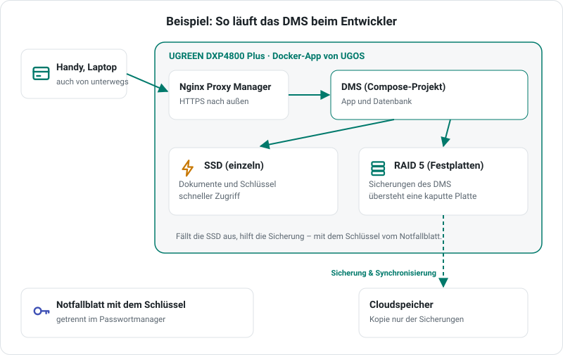

# So läuft es beim Entwickler

Diese Seite zeigt, wie das DMS bei mir zu Hause im Alltag läuft. Das ist **ein Beispiel, keine Empfehlung und kein Muss**. Jedes andere NAS, ein Mini-PC oder ein alter Rechner mit Docker tut es genauso, die Anleitungen dazu stehen links. Hier geht es darum, *warum* ich etwas so gemacht habe. Vielleicht hilft das bei deinen eigenen Entscheidungen.

{ style="display:block;max-width:100%;height:auto;margin:1em auto;border-radius:14px" }

## Das Gerät

Das DMS läuft auf einem **UGREEN DXP4800 Plus** mit der **Docker-App von UGOS**. Darin ist das DMS ein *Projekt* mit der Compose-Vorlage, die auch in der Anleitung für [UGREEN](ugreen.md) steht. Es gibt keine Sonderlösung: Ich nutze dieselbe Vorlage wie alle anderen. So merke ich selbst, wenn an der Anleitung etwas hakt.

## Zugriff von unterwegs

Ein zweiter Container, der **[Nginx Proxy Manager](https://nginxproxymanager.com/)** (`jc21/nginx-proxy-manager`), veröffentlicht das DMS nach außen, mit HTTPS-Zertifikat. So nutze ich das DMS vollständig vom Handy aus, auch unterwegs. Die Daten bleiben trotzdem auf dem NAS zu Hause.

Im DMS ist dafür nur die öffentliche Adresse unter **Werkbank → E-Mail und Adresse** eingetragen. Dass die Anfragen über den Proxy kommen, erkennt das DMS von selbst. Was dahintersteckt, steht im Administratorhandbuch unter [Hinter einem Reverse-Proxy](https://motom001.github.io/dms/admin/aktuell/installation/#hinter-einem-reverse-proxy).

!!! tip "Erst einrichten, dann veröffentlichen"
    Mach das DMS erst von außen erreichbar, wenn die Einrichtung abgeschlossen ist.

## Speicher: schnell, wo es zählt – sicher, wo es zählt

UGOS kann mehrere Speicherpools und Volumes anlegen. Das nutze ich, um die Ordner des DMS nach ihrem Zweck zu verteilen:

| Ordner | liegt auf | Warum |
|---|---|---|
| Dokumente (`files`) und Schlüssel (`geheim`) | einer einzelnen **SSD** | Dokumente öffnen und durchsuchen soll schnell gehen. |
| Sicherungen (`sicherung`) | einem **RAID 5** aus normalen Festplatten | Die Sicherungen überstehen den Ausfall einer Platte. |
| Kopie der Sicherungen | einem **Cloudspeicher** außer Haus | Die UGREEN-App **Sicherung & Synchronisierung** kopiert *nur* den Ordner `sicherung` dorthin – für den Fall, dass dem ganzen NAS etwas passiert. |

Die Pfade passe ich dafür einfach in der Compose-Konfiguration an. Das DMS selbst merkt davon nichts.

## Die bewusste Abwägung

Die SSD ist **einzeln**. Fällt sie aus, sind die Dokumente und der Schlüssel dort weg. Das nehme ich in Kauf, weil zwei Dinge getrennt davon liegen:

- die **Sicherungen**, auf dem RAID und in der Cloud,
- das **[Notfallblatt](https://motom001.github.io/dms/admin/aktuell/sicherung/#notfallblatt)** mit dem Schlüssel, in meinem Passwortmanager auf dem Handy.

Mit beidem lässt sich das DMS auf einem neuen Datenträger oder einem neuen Gerät [wiederherstellen](https://motom001.github.io/dms/admin/aktuell/wiederherstellen/). Wichtig dabei: Der Schlüssel liegt **nicht** bei den Sicherungen. Die Sicherungen sind damit verschlüsselt, und wer eine Kopie davon in die Hände bekommt, kann ohne Schlüssel nichts damit anfangen.

Wer mehr Ausfallsicherheit möchte, spiegelt die SSD (RAID 1). Das kostet eine zweite SSD.

## Was ich nicht empfehle, nur weil ich es so mache

- **Das Gerät:** Ich nutze es, weil es zu meinen Anforderungen passt. Einen Partnerlink oder eine Vergütung gibt es dafür nicht, siehe [„So finanziert sich das Projekt“](https://github.com/motom001/dms#so-finanziert-sich-das-projekt).
- **Den Proxy:** Jeder andere Reverse-Proxy geht auch, etwa der eingebaute deines NAS, Caddy oder Traefik.
- **Die Cloud:** Eine USB-Platte bei Verwandten oder ein zweites NAS außer Haus erfüllt denselben Zweck.

Fragen zu diesem Aufbau oder Ideen, was man besser machen könnte, sind in den [Issues](https://github.com/motom001/dms/issues) willkommen.
